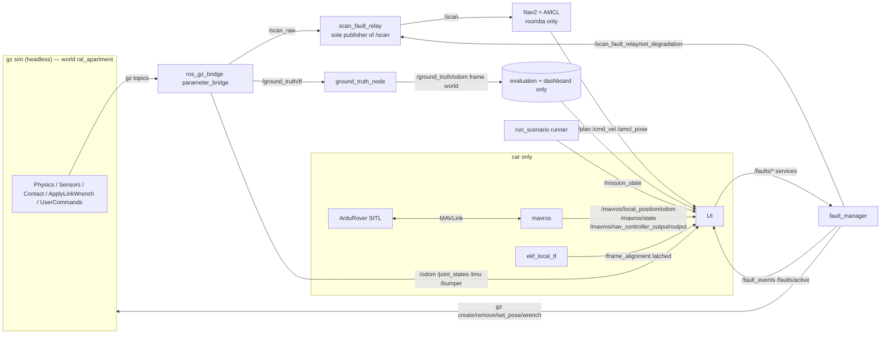

# Operator Dashboard — UI Specification (Phase 6)

> **CTF status banner, added in `ROADMAP.md` P0 (2026-10-29).** This project is now a
> Capture-the-Flag simulation (`README.md`, `ENGINEERING.md` §2). This document is 95 KB of
> still-binding detail and is rewritten in P9, not now. Exactly two of its lines are **already
> false** and are superseded by the phase plan:
>
> - *"Multi-robot / fleet views. One robot per experiment, always."* (§1.3, Forbidden in the UI) —
>   **P1 makes several namespaced robots run in one match**, so a multi-robot view is required, not
>   forbidden. What remains forbidden is a *fleet-command* view: the operator never pilots a robot.
> - *"A20 | No comms-fault control, no fleet view, no confidence score, no success celebration"* —
>   **P4 introduces a real communication fault boundary** (a modeled radio link with range, loss,
>   latency, wall attenuation and jamming), so a comms-fault control becomes legitimate the moment
>   it acts on that link. "No confidence score" and "no success celebration" are **unchanged and
>   still binding**: a fabricated percentage remains forbidden by `ENGINEERING.md` §4.
>
> Everything else in this document still binds.


**Status of this document.** Requirements and constraints for designing the Resilient Autonomy Lab
operator dashboard. It is written to be used **outside this repository**, in an isolated design
environment with no ROS, no Gazebo and no container: everything the design needs — topic names,
message fields, enumerations, units, frames, bounds, verbatim strings, measured value ranges and
real example payloads — is reproduced here.

**What this document is not.** It is not a visual design, not a component library, and not an
implementation plan for Phase 6. It defines *what must be true* of the UI. Where it fixes a colour
or a label, that is because the value is already load-bearing elsewhere in the project (RViz config,
`plot_run.py`, a `.msg` contract) and a second convention would make two artifacts disagree.

**Binding language.** MUST / MUST NOT / SHOULD / MAY as in RFC 2119. Every MUST in §2 traces to
`ENGINEERING.md` or to a committed contract file and is non-negotiable. `[CHOSEN]` marks a value
this spec selects (threshold, layout, priority) that is not itself measured. `[MEASURED]` marks a
number produced by a committed run. `[NOT IMPLEMENTED]` marks a backend capability the UI depends
on that does not exist in the repository today.

**Spec answers to `CLAUDE.md`'s review questions.**

| Question | Answer |
| --- | --- |
| Robotics objective | Make the existing robotics vertical slice *inspectable and operable*: expose the real mission lifecycle, the real fault lifecycle, the robot's own estimate against simulator truth, and the real sensor stream — without adding any behaviour of its own. |
| Supported platforms | `roomba` (Nav2 + AMCL) and `car` (ArduRover SITL + MAVROS + EKF3), in world `ral_apartment`, as described by `ros2_ws/src/ral_bringup/config/robots/<robot>.yaml`. |
| Observed mechanism | The dashboard subscribes to the same topics `ros2 bag record` records and calls the same `/faults/*` services the scenario runner calls. It introduces no new source of truth. |
| Proof | §12 acceptance checklist; every panel names the topic/field it renders and the state it shows when that topic is absent. |
| Limitations | Live-goal entry, stack lifecycle control and the websocket bridge do not exist yet (§3.3). Live metrics are derived values, never the run's metrics (§6.9). The car publishes no numeric pose uncertainty at all (§4.6). |

---

## 1. Product frame

### 1.1 What the operator does

From `README.md:17-22`, one continuous workflow:

1. **Choose a robot** — a real platform, not a skin. The choice changes valid faults, telemetry, the
   estimator, the command semantics and the motion constraints.
2. **Configure the world** — one authored world; unsupported options are visibly unsupported, never
   silently absent.
3. **Set the mission** — pick a destination, issue it.
4. **Observe the run** — plan, actual motion, estimate, operational state, sensor status, commands,
   telemetry.
5. **Interfere in real time** — obstacles, sensor faults, capability faults; repeatedly, within one
   mission.
6. **Inspect the outcome** — timeline, subsystem signals, resulting behaviour, terminal outcome.

The UI exists to answer four questions (`README.md:24`), and every panel SHOULD be justifiable
against one of them:

> **What changed? What did the robot perceive? Why did it respond that way? Was the response safe and
> physically plausible?**

### 1.2 Two surfaces

| Surface | Priority | Purpose |
| --- | --- | --- |
| **A. Live console** | MUST (MVP) | Attach to a running stack; configure, start, observe, interfere, read the terminal outcome. Plan `6.2`. |
| **B. Run inspector** | MUST (MVP) | Open a completed run directory (`runs/<experiment_id>_<UTC>Z/`) and read its evidence: `metrics.json`, `run.json`, `env.json`, `scenario.yaml`, `plot.png`, bag manifest. Required by `README.md:101` (re-run a baseline and a disrupted scenario and *explain the behaviour using evidence*) and `ENGINEERING.md:148`. |
| C. Run comparison | SHOULD | Two or more runs side by side (baseline vs disrupted; roomba vs car on `narrow_doorway_*`). Refuses to mix runs whose `image_ref`, `git_sha` or `scenario_sha256` differ — that refusal already exists in `scripts/checks/repeatability_report.py` and MUST be reproduced, not relaxed. |

Surface B is not optional polish: three of the seven reviewer criteria in `README.md:96-102` are
evidence-reading tasks, and a live console alone cannot satisfy them.

### 1.3 Non-goals

Forbidden in the UI, explicitly (`README.md:56-64`, `ENGINEERING.md:11,124,154`):

- Multi-robot / fleet views. One robot per experiment, always.
- Any claim about physical-hardware safety.
- Any "always recovers" framing, success-biased styling, or celebration of goal reach over safe stop.
- Any animation, interpolation, icon or counter that moves without a message behind it.
- A "connection lost" indicator that is about the dashboard's own websocket presented as a robot
  comms fault (`ENGINEERING.md:101-102`). Dashboard link state and robot comms are different things
  and MUST be labelled differently; there is no comms fault in the catalogue today (§4.7).

---

## 2. Hard constraints

These are acceptance criteria for the design, not guidance. ID them in design reviews.

| ID | Constraint | Source |
| --- | --- | --- |
| **C1** | Every displayed value carries one of exactly five provenance labels: **simulator truth**, **robot estimate**, **measured**, **operator command**, **derived**. The label is visible without hover. | `ENGINEERING.md:116` |
| **C2** | Simulator truth and the robot's estimate are both drawn and MUST never be confusable. Truth is red `#FF0000`, estimate is blue `#00AAFF`, and the provenance word appears in the layer label itself. | `ral.rviz:17-19`, `plot_run.py` palette |
| **C3** | Truth is marked **evaluation only** wherever it appears, and MUST never be presented as an input to navigation or localization. No navigation component in this project subscribes to `/ground_truth/*` and the UI must not imply otherwise. | `ENGINEERING.md:45-46`, `ral.rviz:272` |
| **C4** | Unavailable ≠ zero. A value with no source renders as `unavailable` **plus the verbatim reason string** from the producing artifact. Never `0`, never `—` alone, never an interpolated or last-known value presented as current. | `ENGINEERING.md:128`, `README.md:90`, `metrics.py` (`a null metric must carry a reason`) |
| **C5** | No uncertainty or confidence widget without a defined estimator metric behind it. `roomba`: AMCL covariance trace (converged below `0.25`). `car`: **nothing numeric exists** — `/mavros/estimator_status` carries zero messages on this vehicle and ArduPilot sends no `LOCAL_POSITION_NED_COV`. A percentage, a bar or a star rating invented from anything else is forbidden. | `ENGINEERING.md:48`, `config/robots/car.yaml:62-85` |
| **C6** | A fault control is shown as available only when the selected robot's profile lists that kind under `faults:`. An unsupported kind renders **disabled with its verbatim reason text**, never hidden. Today the only authored reason is `car` → `scan_degradation`: `"ArduRover's navigation does not consume the lidar; degrading it has no effect on this platform."` | `ENGINEERING.md:74`, `config/robots/car.yaml:191-192` |
| **C7** | The fault lifecycle is **four observed states** — `requested`, `activated`, `rejected`, `cleared` — and the UI MUST distinguish *request sent* from *effect confirmed*. A control that has been clicked is not an active fault. A fault that never reached `activated` can never show `cleared`. | `FaultEvent.msg:16-46` |
| **C8** | Mission state vocabulary is the closed set in `MissionState.msg` and the terminal `outcome` string is shown **verbatim, with its stack prefix** (`nav2:STATUS_SUCCEEDED`, `mavros:reached_wp_radius`, `runner:not_sent:goal_cell_occupied`, …). No paraphrase, no "Completed ✓", no inferred cause. | `MissionState.msg:72-144` |
| **C9** | A non-success outcome is a first-class result and MUST be styled as a legitimate experimental finding, not as an error, alarm or failure state of the application. Reaching the goal is not evidence of safety. | `ENGINEERING.md:85,133`, `README.md:104` |
| **C10** | All times displayed for robotics events are **sim time off `/clock`**. Wall time appears only where the thing being timed is a wall-clock process (bring-up, build, websocket). Axis and column headers say which. | `gate.md:155-158`, every `.msg` stamp doc |
| **C11** | A displayed event requires evidence from the producing system. "Replanned" is not displayable; `/plan` publication count is (and the BT republishes at 1 Hz with or without a fault). "Recovered" is not displayable; Nav2's `number_of_recoveries` is. | `ENGINEERING.md:116`, `metrics.py` `plan_publications` definition |
| **C12** | Honesty notes travel with the control. `fault_catalogue.yaml`'s `honesty_note` for a kind MUST be rendered verbatim wherever that kind is named — in the control, in the active-fault entry and in the timeline detail. | `fault_catalogue.yaml:57-60` |
| **C13** | Lidar `+inf` means **no return** (REP 117). It MUST render as absence — no point drawn — never as range 0 and never clamped to `range_max`. | `scan_degradation.py:26-37` |
| **C14** | Ground-truth twist carries `twist.covariance[0] = -1.0` to mean *velocity unknown*; truth pose covariance is all-zero and is not a confidence. Neither may be rendered as a number the robot knows. | `ground_truth_node.py` |
| **C15** | Every view is keyed to a stable experiment identity and shows full provenance on demand: run id, `image_ref`, `git_sha`, `git_dirty`, `map_sha256`, `scenario_sha256`, `world_to_map`. | `ENGINEERING.md:120`, `env.json` |
| **C16** | The UI performs no robotics computation that a backend node already performs, and no computation at all that would constitute an inference about the robot's internal state. Derived live values (§6.9) use the published definitions and are labelled `derived (live)`. | `ENGINEERING.md:116`, §6.9 |
| **C17** | Operator commands are visually distinct from system-confirmed outcomes. A sent request shows as *pending* until the service response or the corresponding `FaultEvent`/`MissionState` arrives. Optimistic UI is forbidden. | `ENGINEERING.md:113`, `FaultEvent.msg:28-31` |
| **C18** | Robot-specific topic sets must be respected: the `car` has **no** `/plan`, `/cmd_vel`, `/odom`, `/amcl_pose`, `/initialpose`, `/map`, `/global_costmap/*`, `/local_costmap/*`, no Nav2 action topics and no `odom` frame. The `roomba` has no `/mavros/*` and no `/frame_alignment`. Panels that have no source for a platform render `unavailable` with the platform reason, and MUST NOT be laid out as if the data were merely late. | `config/robots/*.yaml`, `bridge_car_ral_apartment.yaml` |
| **C19** | Where a capability cannot be grounded, present it as experimental or incomplete rather than implemented. Anything in §3.3 that is still `[NOT IMPLEMENTED]` renders disabled with the reason. | `ENGINEERING.md:170` |
| **C20** | Faults may overlap and may be injected repeatedly within one mission; their combined real effects stand. The UI MUST NOT offer a "reset" that returns the world to a clean state behind the operator's back. (`/faults/clear_all` is honest removal and is allowed; it emits `cleared` events.) | `ENGINEERING.md:76`, `fault_manager.py` `_on_clear_all` |

---

## 3. System context

### 3.1 What produces the data



Two facts the design depends on:

- `scan_fault_relay` is the **sole publisher of `/scan`**, so AMCL and both costmaps are downstream of
  the lidar fault by construction, and `/scan_raw` stays available as the undegraded comparison.
- Truth reaches the dashboard only on `/ground_truth/odom` (frame `world`, child `base_link_truth`)
  and **never enters `/tf`**; a build test fails if it does.

### 3.2 Two stacks, one vocabulary

| | `roomba` | `car` |
| --- | --- | --- |
| gz model | `ral_roomba` | `ral_car` |
| Kinematics | differential drive, rotates in place (`min_turn_radius_m: 0.0`) | Ackermann (parallel steering), `min_turn_radius_m: 0.611` |
| Planner | Nav2 (`navfn` global, DWB local) | **none** — ArduRover drives straight at the setpoint |
| Localization | AMCL over `/scan` against the committed map | ArduPilot EKF3 (IMU + SITL GPS), frame `ekf_local` |
| Command | `/cmd_vel` `geometry_msgs/msg/Twist` (velocity_smoother output) | `/mavros/setpoint_position/local` `geometry_msgs/msg/PoseStamped` |
| Outcome source | `/navigate_to_pose/_action/status` (verbatim `GoalStatus`) | `/mavros/state` + `wp_dist` + runner policy |
| Numeric uncertainty | covariance trace, converged below `0.25` | **none exists** |
| Plant | `0.46 m/s`, `1.9 rad/s` | `1.0 m/s`, `1.64 rad/s` |
| Footprint radius | `0.18 m` (nav2 `robot_radius`; body radius `0.1675 m`) | `0.292 m` (half-diagonal of the 0.50 × 0.30 hull) |
| Goal tolerance | `0.12 m` | `1.0 m` (`WP_RADIUS`) **and** `arrival_estimate_tolerance_m 1.5` |
| Faults supported | all five | four; `scan_degradation` refused with a reason |
| Bring-up budget | `90 s` wall | `240 s` wall |
| Typical mission | `37.5–38.1 s` sim `[MEASURED]` | `5.7–10.4 s` sim `[MEASURED]` |
| Typical RTF | `≈1.0` | `0.34–0.52` (SITL lockstep) `[MEASURED]` |

### 3.3 Backend prerequisites

> **Phase 6 status (implemented).** B1–B5 are no longer missing: they are all served by one
> process, `ral_eval/ral_eval/dashboard_api.py`, started by `scripts/dashboard.sh` on
> `http://localhost:8771`. The transport is **JSON over SSE (`GET /api/stream`) for telemetry and
> HTTP POST for operator actions**, carrying the §4 view model — not `foxglove_bridge` and not
> `@foxglove/ws-protocol`, which the original B1 assumed. It is labelled **"dashboard link"** in the
> UI and is never presented as a robotics protocol. B6 is unchanged and remains out of scope.
>
> Each row keeps the record of what was absent and names what implements it now. A disabled state
> with a reason is still REQUIRED for every one, because each can still be unavailable at runtime —
> no gateway, no stack, no fault manager — and R-I4 says a control that cannot act must say why.

| ID | Capability | Originally missing because | Implemented by | Still-disabled state |
| --- | --- | --- | --- | --- |
| **B1** | A transport between the browser and ROS | `ros-humble-foxglove-bridge` is installed in the image (`docker/Dockerfile:49`) but launched nowhere and bound to no port | the gateway's `TelemetryNode` + `GET /api/stream`; `foxglove_bridge` stays installed for ad-hoc debugging only | EventSource closed → `dashboard link ○ disconnected`, every control disabled with that reason, the stream gap hatched (R-TR5) |
| **B2** | Interactive goal entry | `ral_interfaces/srv/StartMission` is generated but has **zero consumers**; its docstring says "NOTHING in Phase 3 implements this" (`StartMission.srv:18-21`) | `POST /api/mission/start` and `/api/mission/cancel`, driving `ral_eval.mission_node.MissionNode` and the profile's own `MissionDriver`. `StartMission.srv` remains unused: the gateway is not a ROS service | `Start mission` disabled unless the stack is `ready` and no mission is active, with the current state named |
| **B3** | Stack lifecycle control | robot and world bind at launch (`gz`, bridge, `map_server`, AMCL, costmaps, SITL all take them as launch arguments) and nothing exposed a start/stop service | `POST /api/stack/start` / `/api/stack/stop`, launching the profile's `stack_launch` with the runner's own argv. Switching robots is therefore still a **relaunch**, now driven from the browser | refused while another `/clock` publisher exists in the domain, and while a mission is running |
| **B4** | A `/mission_state` publisher other than the scenario runner | `/mission_state` had exactly one publisher, `run_scenario` | the same one: `MissionNode` was extracted from `run_scenario.ScenarioRunner`, so the runner and the gateway publish through **one** class with one outcome-vocabulary gate | no stack → `no mission state published`, never an invented idle |
| **B5** | Run-artifact access | `runs/` holds container paths (`run.json` records `/ws/runs/...`), unreachable from a browser | `GET /api/runs`, `/api/runs/<id>`, `/api/runs/<id>/plot.png` | a malformed run directory is listed `partial` with its reason, never hidden |
| **B6** | Any communication/link-loss fault | **not in the catalogue at all** — the five kinds in §4.7 are the whole set (`fault_catalogue.yaml`) | *nothing; still out of scope* | no comms-fault control may be designed. `ENGINEERING.md:100-102` |

---

## 4. Data contract

The design environment builds against the **view model** in this section: plain JSON, no ROS types,
no units left implicit. Field names below are the view-model names; the ROS origin is given for
every one so nothing is invented.

> **Phase 6 status (implemented).** The adapter is `ral_eval/ral_eval/dashboard_api.py`. Its
> module-level `encode_*` functions are that 1:1 map — one per message type, pure, transcoding and
> never interpreting. `ral_eval/test/test_dashboard_api.py` pins the cases where a transcription
> could become a claim: a no-return drawn as a range, an unknown twist drawn as a standstill, a
> manager string paraphrased.

### 4.1 Session and transport model

> **Phase 6 status (implemented).** The link is **JSON over Server-Sent Events** for telemetry
> (`GET /api/stream`, one `data:` frame per `{topic, payload}`, a 15 s keepalive comment, and a
> `dropped` frame when a client's bounded queue overflows) and **HTTP POST** for operator actions
> (`/api/stack/start|stop`, `/api/mission/start|cancel`, `/api/faults/<kind>`). It is not a
> websocket and not a ROS transport; the UI calls it the **dashboard link**.
>
> `LinkState` below is therefore the browser's view of its own `EventSource`, which is exactly what
> C1 requires: a dropped socket is never rendered as a robot fault. On reconnect the gateway
> replays the last frame of every topic it has seen, which is how R-TR1's latched-topic behaviour
> survives a transport that has no QoS of its own.

```ts
type LinkState =
  | { kind: 'disconnected' }                       // never show this as a robot fault — C1/§1.3
  | { kind: 'connecting';  since_wall_ms: number }
  | { kind: 'connected';   since_wall_ms: number; url: string }
  | { kind: 'error';       message: string };      // verbatim transport error
```

Rules:

- **R-TR1** Latched (`TRANSIENT_LOCAL`) topics deliver their last value on subscribe: `/faults/active`,
  `/mission_state`, `/fault_events`, `/map`, `/tf_static`, `/frame_alignment`. A late-joining UI
  therefore has state immediately and MUST NOT render "waiting" for them once connected.
- **R-TR2** `/faults/active` is latched **and published empty at manager start-up**, so an empty
  snapshot means "no faults in force" and *absence of the topic* means "the fault manager is not
  running". These two MUST render differently.
- **R-TR3** The sim clock is authoritative. The UI keeps `sim_now_s` from `/clock` and derives every
  age/duration from it. If `/clock` stops advancing while the link is up, that is a **stalled
  simulation**, and the UI says so (the runner's own equivalent outcome is `runner:unknown:clock_stalled`).
- **R-TR4** `/scan`, `/scan_raw`, `/imu` and `/mavros/local_position/odom` are BEST_EFFORT sensor QoS.
  Gaps are normal and are not errors.
- **R-TR5** Reconnect MUST NOT clear accumulated history the UI has already rendered (timeline,
  trails); it MUST mark the gap. Inventing a straight line across a reconnection gap is forbidden (C2/C16).

### 4.2 Clock and staleness

```ts
interface Clock {
  sim_now_s: number;          // /clock, seconds
  wall_now_ms: number;        // browser clock, for link ages only
  rtf_window: number | null;  // gz stats real_time_factor, windowed; null when unavailable
  advancing: boolean;         // sim_now_s increased within the last 2.0 s wall  [CHOSEN]
}
```

Per-stream staleness thresholds. All `[CHOSEN]`, derived from the measured rates; each is a *display*
threshold and never a judgement about the robot:

| Stream | Nominal rate | `stale` after (sim) | Note |
| --- | --- | --- | --- |
| `/ground_truth/odom` | 50 Hz | 0.5 s | truth; a gap means the simulator stopped |
| `/scan`, `/scan_raw` | 10 Hz | 1.0 s | |
| `/cmd_vel` (roomba) | ~20 Hz while navigating | 1.0 s | `DiffDrive` has **no command timeout**: the last command is held indefinitely, so "no new command" does not mean "stopped" (`roomba-teleop-loop.md:59-62`) |
| `/amcl_pose` (roomba) | **motion-gated** (`update_min_d 0.1`, `update_min_a 0.2`) | 3.0 s | A stationary robot publishes nothing. Render as *last update age*, never as an error |
| `/mavros/local_position/odom` (car) | 10 Hz requested | 3.0 s | measured in-mission gaps of **0.14 / 2.88 / 2.59 s**; the stream can stall and then flush |
| `/plan` (roomba) | 1 Hz (BT `RateController hz="1.0"`) | 3.0 s | |
| `/mavros/nav_controller_output/output` (car) | 5 Hz | 2.0 s | |
| `/bumper` | **event-driven** | never | silence is the normal state; "0 collisions" needs the liveness evidence in §6.8 |
| `/mavros/estimator_status` (car) | **zero messages, always** | n/a | render `unavailable` + reason, permanently |

### 4.3 Mission state

ROS: `ral_interfaces/msg/MissionState` on `/mission_state`, depth 10, RELIABLE, TRANSIENT_LOCAL,
single publisher (the runner, today).

```ts
interface MissionState {
  stamp_sim_s: number;
  experiment_id: string;
  state: MissionStateName;
  goal: { frame_id: 'map'; x: number; y: number; yaw_rad: number };  // goal AS SENT
  outcome: MissionOutcome | '';   // '' before a terminal state
  detail: string;                 // verbatim, always displayable
}

type MissionStateName =
  | 'idle' | 'goal_accepted' | 'navigating'
  | 'succeeded' | 'aborted' | 'canceled'
  | 'unreachable' | 'rejected' | 'unknown';
```

Semantics the UI MUST preserve (`MissionState.msg:16-64`) — each is an **observation**:

| State | Means | Terminal |
| --- | --- | --- |
| `idle` | stack up, bring-up gate passed, no goal sent. `goal` is the goal that *will* be sent | no |
| `goal_accepted` | the action server returned a handle with `accepted=True` (nav2); or the setpoint was published while GUIDED+armed (mavros, which is unacknowledged — say so) | no |
| `navigating` | the stack was **observed executing**: first Nav2 action feedback, or first `wp_dist > goal_tolerance` while GUIDED+armed. Published exactly once | no |
| `succeeded` | the autonomy stack reported arrival | yes |
| `aborted` | reported non-success: Nav2 `STATUS_ABORTED`, autopilot left GUIDED, disarmed, or the runner's deterministic no-progress policy | yes |
| `canceled` | the runner asked the stack to stop (after `timeout_sec`) and it did | yes |
| `unreachable` | **pre-flight refusal only**; the goal was never sent | yes |
| `rejected` | the server refused the goal; no `GoalStatus` ever existed | yes |
| `unknown` | accepted and executed, and no terminal status ever arrived | yes |

**`unreachable` is never inferred from an abort.** The UI MUST NOT relabel an abort as "unreachable",
and MUST NOT display a cause for an abort that the stack did not state.

Closed `outcome` set — display verbatim (`MissionState.msg:113-144`):

```
nav2:STATUS_SUCCEEDED   nav2:STATUS_ABORTED   nav2:STATUS_CANCELED   nav2:unknown:status_<n>
mavros:reached_wp_radius      mavros:mode_changed:<MODE>   mavros:disarmed
mavros:stalled_no_progress    mavros:canceled_timeout
mavros:not_accepted:set_mode  mavros:not_accepted:arming   mavros:unknown:no_terminal
runner:not_accepted
runner:not_sent:goal_cell_occupied   runner:not_sent:footprint_outside_map
runner:not_sent:initial_pose_occupied
runner:unknown:no_terminal_status    runner:unknown:clock_stalled
runner:bringup_failed   runner:bag_missing   runner:exception       ← run.json only, never on the topic
```

`mavros:stalled_no_progress` MUST be captioned as what it is: a **deterministic policy in the
runner, not autonomy** — the UI repeats the driver's own `detail`, e.g.

> `the robot's own estimate moved 0.066 m in 15.0 s sim, less than the 0.25 m this driver requires over 15 s. This is a DETERMINISTIC POLICY in the runner, not a decision the autopilot made: ArduRover carries no obstacle avoidance and would keep pushing until the scenario timeout. HOLD was commanded. Last wp_dist 7.0`

Real `detail` strings to design against:

| State | `detail` (real) |
| --- | --- |
| `idle` | `stack up, goal not yet sent; \`goal\` is the goal that will be sent` |
| `goal_accepted` (nav2) | `goal_id c3fe11e7eaba40c38397314458253d0f` |
| `goal_accepted` (mavros) | `GUIDED position setpoint published at (5.495, -0.249) in ekf_local; SET_POSITION_TARGET_LOCAL_NED is not acknowledged, so acceptance here means published while the mode was GUIDED and the vehicle armed` |
| `navigating` | `the stack was observed executing the goal at sim 30.21 s` |
| `succeeded` (nav2) | `distance_remaining=0.11603768169879913, number_of_recoveries=0; from /navigate_to_pose status 4` |
| `succeeded` (mavros) | `/mavros/nav_controller_output/output reported wp_dist 1 m within WP_RADIUS 1 m on 3 consecutive messages while the mode was GUIDED and the vehicle armed, having first reported a distance beyond that tolerance, AND the robot's own estimate was 0.78 m from the commanded setpoint, within the profile's arrival_estimate_tolerance_m 1.50. wp_dist is the FCU's own distance to its target and is uint16 METRES, so the estimate gap is what bounds where this vehicle came to rest.` |
| `unreachable` | `41 cell(s) within 0.18 m of the goal at map (7.500, 0.000), grid cell (160, 11) of 241x162 at 0.05000000074505806 m: 0 unknown (allowed, planner allow_unknown is true), 21 occupied (>= 65), 0 outside; the goal centre cell is inside the grid with value 100; occupied cells: (159,8)=100, (160,8)=100, …` |

`detail` is long. It MUST be fully readable (expandable block or copy control), never truncated to the
point where the stated reason is lost.

### 4.4 Fault events and the active set

ROS: `ral_interfaces/msg/FaultEvent` on `/fault_events` (depth 10, RELIABLE, TRANSIENT_LOCAL) and
`ral_interfaces/msg/ActiveFaults` on `/faults/active` (depth 1, latched).

```ts
interface FaultEvent {
  stamp_sim_s: number;
  id: string;             // '<kind>_<n>' from a scenario, '<kind>_ui_<n>' when the dashboard sent it
  kind: FaultKind;
  injection_point: string;// literal gz topic/service or ROS node — never a description
  target: string;         // 'ral_roomba' | 'ral_car' | obstacle name | '/scan'
  state: 'requested' | 'activated' | 'rejected' | 'cleared';
  detail: string;         // parameters applied, or the rejection reason verbatim
}

interface ActiveFaults {           // SNAPSHOT, not history
  stamp_sim_s: number;
  active: FaultEvent[];            // each is the 'activated' event verbatim, detail refreshed
}
```

Rules:

- **R-F1** `/faults/active` is the only authoritative answer to "what is broken right now". The UI
  MUST NOT compute the active set by replaying `/fault_events`; two implementations of that rule
  would eventually disagree (`ActiveFaults.msg:16-24`).
- **R-F2** `id` joins the four transitions of one fault instance. The timeline groups by `id`.
- **R-F3** One-shots (`kidnap`, `clear_obstacle`) never appear in `/faults/active` and MUST NOT be
  given a clear control (`fault_catalogue.yaml:48-52`).
- **R-F4** `requested` means *nothing in the world has changed yet*. It MUST be visually weaker than
  `activated` and must never be counted as an active fault (C7/C17).
- **R-F5** A `cleared` can only follow an `activated` for the same `id`.
- **R-F6** Re-enabling a singleton **supersedes**: the old instance gets `cleared` with
  `detail = 'superseded by <new id>'`, the new one gets `activated`. The UI shows one active entry,
  and the timeline shows both events.
- **R-F7** A new mission auto-clears every active fault: on a `/mission_state` `goal_accepted` with a
  new stamp, the manager emits `cleared` with reason `cleared at mission start`. The UI MUST show
  those events and MUST NOT present the clearing as its own doing.
- **R-F8** A failed removal publishes `rejected` with
  `'<reason> FAILED, the fault is still in force: <detail>'` and the entry **stays active**.
  The UI must keep showing it as active.

### 4.5 Pose, path, scan, grid

```ts
interface Pose2D { x: number; y: number; yaw_rad: number; }

interface TruthPose {                   // /ground_truth/odom — SIMULATOR TRUTH, evaluation only
  stamp_sim_s: number;
  frame: 'world';                       // child frame: base_link_truth
  pose: Pose2D;
  twist: { linear_x: number; angular_z: number; known: boolean };  // known=false when covariance[0] === -1
}

interface EstimatePose {                // profile estimate.topic
  stamp_sim_s: number;
  frame: 'map' | 'ekf_local';
  pose: Pose2D;
  covariance_trace: number | null;      // roomba: cov[0]+cov[7]+cov[35]; car: null
  label: string;                        // profile estimate.label, verbatim
}

interface Plan { stamp_sim_s: number; frame: 'map'; poses: Pose2D[]; }

interface Scan {                        // /scan and /scan_raw
  stamp_sim_s: number;
  frame: 'rplidar_link';
  angle_min_rad: number;  // -3.14159…
  angle_increment_rad: number; // 0.017502 for 360 beams
  range_min_m: number;    // 0.15
  range_max_m: number;    // 12.0
  ranges: (number | null)[];  // null === +inf === NO RETURN  (C13)
}

interface OccupancyGrid {               // /map (roomba only) or the inspector's map file
  frame: 'map';
  resolution_m: number;   // 0.05000000074505806
  width: number; height: number;        // 241 x 162
  origin: Pose2D;         // [-0.506, -0.585, 0]
  data: Int8Array;        // -1 unknown, 0..100; occupied_thresh 65, free_thresh 25, trinary
}

interface FrameAlignment {              // /frame_alignment (car only), latched; an OFFSET, never a pose
  stamp_sim_s: number;
  parent_frame: 'world'; child_frame: 'ekf_local';
  x: number; y: number; yaw: number;
  residual_m: number; residual_yaw_rad: number;
  source: string;                       // e.g. '/ground_truth/odom and /mavros/local_position/odom, both stationary at the spawn pose'
}
```

**Frames — the one arithmetic rule the UI is allowed to do.** Three frames exist and they do not
coincide:

| Frame | Who defines it | Used by |
| --- | --- | --- |
| `world` | gz | truth, spawn poses, obstacle poses, kidnap poses, scenario `initial_pose`/`goal` |
| `map` | `slam_toolbox`, at the robot's pose when mapping started | AMCL, Nav2, `/map`, the goal as sent |
| `ekf_local` | ArduPilot EKF3, at the autopilot's first GPS fix | the car's estimate |

`world_to_map` is **measured and committed**: for the `apartment` map it is `{x: 0.5, y: 0.5, yaw: 0.0}`
(`maps/apartment_frames.yaml`, `captured_utc 2026-10-22T15:32:41Z`), i.e. `map = world − (0.5, 0.5)`
at yaw 0. `world_to_ekf_local` is **per run** and arrives on `/frame_alignment`
(a committed baseline measured `{x: 0.9990, y: 3.9989, yaw: 0.0454, residual_m: 0.0015}`).

- **R-FR1** The UI converts poses between frames **only** with these published values, and MUST label
  which transform it used.
- **R-FR2** If the alignment is missing, positions that would require it render `unavailable` with that
  reason. An implicit identity transform is forbidden — it publishes a frame offset as localization
  error (this is exactly the rule `metrics.py` enforces).
- **R-FR3** The 2D view's working frame is `map` (same as RViz's fixed frame). Truth is converted into
  `map` for drawing and the label still says *simulator truth (world → map via the measured alignment)*.

### 4.6 Robot profile — the UI's capability source

`ros2_ws/src/ral_bringup/config/robots/<robot>.yaml` is the single source for everything
platform-specific. The dashboard MUST read it (via the adapter) and MUST NOT hardcode any of it.

```ts
interface RobotProfile {
  robot: 'roomba' | 'car';
  model: string;                      // gz entity name: 'ral_roomba' | 'ral_car'
  stack_launch: string;
  spawn: { x: number; y: number; z: number; yaw: number; z_source: string };
  estimate: {
    topic: string; type: string; frame: string; label: string; tf_source: string;
    uncertainty:
      | { kind: 'covariance_trace'; converged_below: number }
      | { kind: 'estimator_status'; topic: string };
  };
  command: { kind: 'velocity_twist' | 'position_setpoint'; topic: string; label: string };
  mission_driver: 'nav2' | 'mavros_guided';
  plant: { max_linear_m_s: number; max_angular_rad_s: number; min_turn_radius_m: number; source: string };
  footprint: { radius_m: number; source: string };
  goal_tolerance_m: number;
  arrival_estimate_tolerance_m?: number;   // car only
  kidnap_z_m: number;
  bringup_wall_limit_s: number;
  bringup_topics: { topic: string; type: string }[];
  record_topics: string[];
  faults: FaultKind[];
  unsupported?: Record<FaultKind, string>; // verbatim reason text — C6
  estimator_label: string;                 // 'AMCL' | 'EKF3'
  mobility_note: string;                   // measured deficit ladder for THIS plant
}
```

Values today (both profiles, verbatim fields): see §3.2 and Appendix B.3. Two notes the UI must
surface rather than smooth over:

- `car.estimate.uncertainty.kind = 'estimator_status'` and that topic carries **zero messages**:
  ArduRover refused the `SET_MESSAGE_INTERVAL` request (`MessageInterval_Response success=False`).
  So the car's uncertainty readout is permanently `unavailable` with that reason (C5).
- `roomba.footprint.radius_m` is `0.18` and comes from `nav2_roomba.yaml global_costmap.robot_radius`;
  the modelled body radius is `0.1675`. If both are drawn they must be labelled differently.

### 4.7 Fault catalogue — the UI's control metadata

`ros2_ws/src/ral_faults/config/fault_catalogue.yaml`. Its header names the dashboard as a reader.
Five kinds, no more (B6):

| kind | category | service | lifetime | cleared_by | alters_truth | UI control shape |
| --- | --- | --- | --- | --- | --- | --- |
| `spawn_obstacle` | `environment` | `/faults/spawn_obstacle` | `keyed_set` | `clear_obstacle` | `true` | add-form, many instances, each clearable by name |
| `clear_obstacle` | `environment` | `/faults/clear_obstacle` | `oneshot` | `null` | `true` | action **on an existing spawn**, not a standalone form |
| `scan_degradation` | `perception` | `/faults/set_scan_degradation` | `singleton` | `self_disable` | **`false`** | one parameter form; enabling again supersedes; clear = `enabled:false` |
| `mobility_fault` | `dynamics` | `/faults/set_mobility_fault` | `singleton` | `self_disable` | `true` | one wrench form; clear = `enabled:false` |
| `kidnap` | `state` | `/faults/kidnap` | `oneshot` | `null` | `true` | one-shot button + pose; **no clear control** |

Plus `/faults/clear_all` — `std_srvs/srv/Trigger`, empty request; response
`message = '<n> fault(s) cleared, <m> could not be cleared'`, `success = (m == 0)`.

`alters_truth` is a display requirement, not trivia: `scan_degradation` is the only kind that does
**not** change the world, and its honesty note says so. The UI MUST group or badge faults by whether
they move truth, because that is what tells an operator whether a divergence they see is the robot
being wrong or the world having changed.

**Verbatim honesty notes** (render with the control — C12):

- `scan_degradation`:
  > Corrupts the LaserScan stream between the sensor bridge and its consumers. The simulated lidar itself stays healthy: Gazebo Harmonic cannot change SDF sensor noise at runtime.
- `mobility_fault`:
  > An external wrench on the base link, not a degraded actuator. The drivetrain commands joint velocities, so the wrench changes motion only once it exceeds what the wheels can absorb. force_x_n/force_y_n are BODY-frame and are re-projected into the world frame, the only frame ApplyLinkWrench accepts. `activated` means the wrench was published with the gz bridge subscribed; gz acknowledges nothing.
- `kidnap`:
  > Teleports the body. Linear and angular velocity are NOT zeroed, so the robot keeps the twist it had, and z is set by the manager (the scenario schema has no z).
- `spawn_obstacle`, `clear_obstacle`: empty — "a fault that is exactly what its name says".

Per-robot `mobility_note`, appended by the manager to the `activated` detail (shown verbatim):

- roomba: `MEASURED on this plant at a commanded 0.400 m/s: -15 N and -30 N produce no deficit at all, -60 N produces 25% and pushes the body backwards, -120 N produces 90%.`
- car: `a body-frame -40 N wrench leaves the mean achieved speed at 0.773 m/s against an unfaulted 0.922 m/s over the same part of the same mission - a 16% deficit, below the 20% this fault is calibrated to - while -80 N reverses it to -0.085 m/s: …`

These are the numbers a parameter form should offer as presets. A preset MUST be labelled with its
measured effect, not with an adjective ("severe", "mild").

### 4.8 Fault services — request, response, validation

All five share the response triple. `fault_id` empty in the request means **allocate one**; the
manager mints `<kind>_ui_<n>` and returns it. The UI MUST send empty and MUST use the returned id to
join its request to the event stream.

```ts
interface FaultResponse { fault_id: string; success: boolean; message: string; }  // message verbatim

// /faults/spawn_obstacle
interface SpawnObstacleReq {
  fault_id: '';                         // UI always sends empty
  name: string;                         // ^[A-Za-z0-9_][A-Za-z0-9_-]{0,63}$
  pose: Pose3;                          // gz WORLD frame, NOT converted through world_to_map
  size: { x: number; y: number; z: number };  // FULL extents in m, each > 0, all finite
}
// /faults/clear_obstacle
interface ClearObstacleReq { fault_id: ''; name: string; }       // must be a name this manager spawned
// /faults/set_scan_degradation
interface SetScanDegradationReq {
  fault_id: ''; enabled: boolean;
  range_noise_stddev_m: number;   // >= 0
  max_range_m: number;            // [0.15, 12.0]
  blind_sector_start_deg: number; // [-180, 180]
  blind_sector_end_deg: number;   // [-180, 180]
  dropout_probability: number;    // [0, 1]
}
// /faults/set_mobility_fault
interface SetMobilityFaultReq {
  fault_id: ''; enabled: boolean;
  force_x_n: number; force_y_n: number;  // BODY frame newtons, finite, otherwise unbounded
  torque_z_nm: number;                   // yaw torque N·m
}
// /faults/kidnap
interface KidnapReq { fault_id: ''; new_pose: Pose3; }  // WORLD frame; z IGNORED, replaced by kidnap_z_m
```

**Validation table — the UI MUST enforce these client-side *and* still display a server refusal
verbatim if one arrives.** Bounds come from `fault_catalogue.yaml param_ranges` and are mirrored by
the scenario schema; an absent range means *finiteness only*, never "unbounded by omission".

| Field | Bound | Why |
| --- | --- | --- |
| `range_noise_stddev_m` | `[0.0, null]` | additive zero-mean Gaussian per beam |
| `max_range_m` | `[0.15, 12.0]` | the modelled RPLIDAR A1's real range; `0.0` (a partially filled request) would blank every beam and report success |
| `blind_sector_start_deg` / `_end_deg` | `[-180.0, 180.0]` | scan frame, CCW start→end; `start > end` wraps through ±180; `start == end` blanks nothing |
| `dropout_probability` | `[0.0, 1.0]` | per-beam no-return probability, RNG seeded by the scenario `seed` |
| `force_x_n`, `force_y_n`, `torque_z_nm` | finite only | any finite wrench is one gz can apply; an implausible one is a visible result, not an invalid request |
| `size.{x,y,z}` | `> 0`, finite | a box extent must be positive |
| obstacle `name` | `^[A-Za-z0-9_][A-Za-z0-9_-]{0,63}$` | substituted into SDF; a name carrying XML would inject world content |
| `new_pose` components | finite | a NaN pose places the body nowhere |

**Refusal strings to design against** (all verbatim from `fault_manager.py` / `catalogue.py`; the UI
displays `response.message`, which equals the `rejected` event's `detail`):

```
range_noise_stddev_m is 2.0; fault_catalogue.yaml declares scan_degradation.param_ranges.range_noise_stddev_m as [0.0, None] and a request outside it is refused rather than applied
max_range_m is nan, which is not a finite number; a wrench, pose or sensor parameter that is NaN or infinite is not a request gz or the relay can apply
obstacle name 'blocker 1' is not [A-Za-z0-9_][A-Za-z0-9_-]{0,63}; the name is substituted into the SDF this manager sends to gz, so a name carrying XML would inject arbitrary world content
obstacle 'blocker_1' is already spawned in this run; gz entity names are unique and a second spawn would fail
'blocker_9' was never spawned by this manager; removing an entity it did not create would report a cleared fault that never existed
no scan_degradation is in force; disabling one that was never activated would report a cleared fault that never existed
no mobility_fault is in force; disabling one that was never activated would report a cleared fault that never existed
scan_degradation is not listed under car in car.yaml; no reason is recorded, and silence in the table is not consent
/faults/spawn_obstacle not available after 10.0 s; the gz service bridge is not running, so the fault was NOT applied
/world/ral_apartment/create returned success=false for 'blocker_1'; gz rejected the entity
no ground-truth pose yet on /ground_truth/odom; the body-frame wrench cannot be projected into the world frame gz requires
no subscriber on /world/ral_apartment/wrench/persistent: the gz bridge is not running, so the wrench would be dropped
no subscriber on /world/ral_apartment/wrench/clear: the gz bridge is not running, so the persistent wrench CANNOT be shown to have been removed and must be assumed still in force
scan_fault_relay refused: <relay message>   (prefix: "<reason> (scan_fault_relay is the injection point; without it /scan is an undegraded copy of /scan_raw)")
```

**Success `detail` strings** (what the timeline will actually show). These are the manager's format
strings with representative parameter values substituted; `spawn`, `mobility` and `kidnap` reproduce
values that appear in committed runs. Note that the `requested` event formats numbers with plain
repr (`force (-80.0, 0.0) N`) while `activated` formats to three decimals — the UI must not normalise
either, since both are verbatim fields.

```
spawn   : gz created static box 'blocker_1' (1.200 x 0.200 x 0.600 m) at world (6.000, 3.000, z=0.300 set to half the box height so it rests on the floor); the lidar sees it from the next sweep
clear   : gz removed 'blocker_1' from the world; the costmaps clear it as the lidar sweeps the space again
scan on : scan degradation in force on /scan: additive Gaussian noise sigma 0.080 m, ranges truncated above 2.500 m, blind sector 90.0 -> 150.0 deg (CCW), per-beam dropout 0.200; RNG reseeded with seed 1, so the corrupted stream repeats for this seed. /scan_raw stays undegraded for comparison
scan off: scan degradation removed after 312 degraded scan(s); /scan is a faithful republish of /scan_raw again (was: noise 0.080 m, max range 2.500 m, blind sector 90.0 -> 150.0 deg, dropout 0.200)
mobility: body-frame force (-80.000, 0.000) N and torque 0.000 N.m published on /world/ral_apartment/wrench/persistent as world-frame (-80.000, 0.155) N at yaw -0.002 rad, after clearing the previous persistent wrench. <honesty_note> On car: <mobility_note>
kidnap  : gz moved ral_roomba to world (2.000, 6.500, z=0.050 substituted by the manager). The body moved with no actuation and no inertial signature, so AMCL is now wrong by the teleport distance and must recover alone. <honesty_note>
```

The active-fault entry for a wrench additionally gains ` [<n> re-projection(s) since]` — the manager
re-projects the body-frame wrench into the world frame at 10 Hz as the body rotates. This is a
display-only counter and MUST NOT be rendered as repeated fault injections.

### 4.9 Run artifacts (Surface B)

A run directory contains exactly eight entries:

```
runs/<experiment_id>_<UTC %Y%m%dT%H%M%SZ>/
├── scenario.yaml   byte copy of the input scenario
├── env.json        provenance, written BEFORE launch
├── run.json        the run record, written LAST
├── metrics.json    metrics_version 5
├── plot.png        1600 x 1000 px, 2x2 panels
├── launch.log      stack stdout/stderr
├── bag_record.log  recorder stdout/stderr
└── bag/{bag_0.mcap, metadata.yaml}
```

Exit codes (surface them; they explain a missing artifact): `0` ran and was measured — **including
aborted, timed-out and refused missions**; `1` map/alignment refused; `2` scenario invalid or run
directory exists; `3` bring-up failed; `4` bag missing/unfinalised/short; `5` metrics or plot raised.

`metrics.json` shape — every metric is an object and there is never a bare number:

```ts
interface Metric<T> {
  value: T | null;
  unit: string;        // 's (sim)' | 'm' | 'count' | 'm/s and rad/s' | 'fraction' | ''
  source: string;      // the topic(s) and the transform applied, verbatim
  definition: string;  // the full definition, verbatim — tooltip/expander copy
  reason: string | null;  // REQUIRED when value is null
}
```

Metric keys, `metrics_version: 5` (complete list):

`mission_duration_s`, `path_length_m`, `teleport_excluded_m`, `goal_pose_error_m`,
`est_error_mean_m`, `est_error_max_m`, `est_error_at_start_pose_m`, `est_cov_trace_max`,
`est_pos_horiz_accuracy_max_m`, `est_status_flags`, `localization_converged_sim_s`,
`collision_count`, `plan_publications`, `stopped_time_s`, `mission_result`, `recoveries`,
`cmd_vs_achieved`, `speed_vs_target`, `fault_to_response_s`, `obstacle_min_clearance_m`,
`scan_degradation_divergence`.

`meta` carries the provenance the inspector must show: `experiment_id`, `run_dir`, `bag`,
`scenario{world,robot,seed}`, `mission_window{t_accept_sim,t_terminal_sim,source,final_state}`,
`robot`, `robot_profile_path`, `estimate_source{…}`, `mission_driver`, `world_to_map`,
`world_to_map_source`, `world_to_ekf_local`, `map_sha256`, `mission_result_source`, `pair_counts`,
`missing_topics`, `topic_status` (`read` | `absent` | `unresolved_type: <…>`),
`plan_detection_resolution_s`, `plan_detection_resolution_source`, `metrics_version`.

`run.json` adds the operational record: `started_utc`, `finished_utc`, `sim_start`, `sim_end`,
`t_accept_sim`, `t_terminal_sim`, `goal_uuid`, `goal_map`, `goal_world`, `initial_map`,
`initial_world`, `world_to_map`, `world_to_ekf_local`, `recorder_unsubscribed_topics`,
`bumper_liveness{ros_publishers,gz_topic,gz_topic_present,gz_detail,alive}`, `initial_yaw_aligned`,
`initial_yaw_error_rad`, `initial_yaw_detail`, `localization_converged`, `localization_cov_trace`,
`localization_converged_sim_s`, `localization_detail`, `warmup_total_sim_s`, `preflight_initial`,
`preflight`, `mission_state`, `outcome`, `mission_driver`, `nav2_status_code`, `nav2_status_name`,
`detail`, `interventions[]`, `rtf_samples`, `bag_dir`, `exit_code`.

`interventions[]` entry (real example):

```json
{ "id": "mobility_fault_1", "type": "mobility_fault", "at_sec": 2.0, "dispatched_sim_s": 2.0,
  "service": "/faults/set_mobility_fault",
  "injection_point": "/world/ral_apartment/wrench/persistent (gz physics)",
  "target": "ral_car",
  "params": {"enabled": true, "force_x_n": -80.0, "force_y_n": 0.0, "torque_z_nm": 0.0},
  "pose_frame": null, "available": true, "success": true,
  "message": "body-frame force (-80.000, 0.000) N …",
  "manager_fault_id": "mobility_fault_1", "result": "applied" }
```

`result` ∈ `applied` | `not_applied` | `not_dispatched:goal_unreachable` |
`not_dispatched:mission_ended_first`.

**Version guard.** Runs below `metrics_version 5` exist in `runs/` (dated 2026-10-23) and differ:
outcomes lack the `runner:` prefix, `run.json` has no `mission_driver`. The inspector MUST refuse to
score them and say which version it found — `repeatability_report.py` already does exactly this.

### 4.10 Scenario schema (read-only in the UI, and the template for a future live mission)

Top-level keys are closed: `experiment_id`, `robot`, `world`, `seed`, `initial_pose`, `goal`,
`timeout_sec`, optional `interventions`. Any other key is rejected.

| key | legal values |
| --- | --- |
| `experiment_id` | 1–64 chars `[a-z0-9_]`, first `[a-z0-9]` |
| `robot` | `roomba` \| `car` |
| `world` | `ral_apartment` **only** |
| `seed` | int (seeds `ral_faults`' RNG only — not AMCL, not the sim, not EKF3) |
| `initial_pose`, `goal` | `{x, y, yaw}` exactly, finite, **gz world frame** |
| `timeout_sec` | finite `> 0`, **sim** seconds |
| `interventions[].at_sec` | finite, `>= 0`, `< timeout_sec`, sim seconds **since goal acceptance** |
| `interventions[].type` | the five fault kinds |

Cross-entry rules the UI must mirror if it ever composes a scenario: two `spawn_obstacle` may not
share a `name`; a `clear_obstacle` must reference an earlier spawn and be strictly later in `at_sec`.

---

## 5. Information architecture

### 5.1 Screens

| Screen | Surface | Contents |
| --- | --- | --- |
| **S1 Console** | A | The live mission. Default screen when a stack is attached. |
| **S2 Runs** | B | List of run directories; filter by robot, scenario, outcome; sort by time. |
| **S3 Run detail** | B | One run's evidence. |
| **S4 Compare** | C | 2–4 runs, same scenario or the `narrow_doorway_*` pair. |
| **S5 Reference** | — | Read-only: fault catalogue with injection points, consumers, honesty notes and limitations; robot profiles; frame alignment; the project's provenance (image, git SHA, map hash). Required by `ENGINEERING.md:66-72` (five documentation fields per fault) and keeps that text out of tooltips. |

### 5.2 Console layout constraints

Not a visual design — a statement of what must be **simultaneously visible** without interaction,
because the console's purpose is to let an engineer watch a causal chain unfold (`ENGINEERING.md:139`).

Required simultaneous set, at ≥1280 px wide:

1. The 2D world view (map + truth + estimate + plan + scan + goal).
2. Mission state and its outcome field.
3. Active faults (count and list).
4. The sim clock and whether it is advancing.
5. At least one divergence readout: live estimate-vs-truth error.

Everything else MAY be in tabs, drawers or a secondary column. The fault **injection** controls MAY be
in a drawer, but the **active fault set** may not.

```
┌───────────────────────────────────────────────────────────────────────────────────────┐
│ S1  [ral_roomba · roomba]  sim 47.90 s ▶  RTF 1.00  link ●  run baseline_roomba_…3934Z │  ← status strip
├──────────────────────────────────────────────┬────────────────────────────────────────┤
│                                              │ MISSION                                │
│   2D WORLD VIEW (frame: map)                 │  state   navigating                    │
│                                              │  goal    map (10.000, 6.000, 1.570)    │
│   ▢ map (static, slam_toolbox)               │  outcome —                             │
│   ▢ global / local costmap                   │  detail  observed executing at 30.21 s │
│   ▬ truth (simulator, evaluation only)  RED  ├────────────────────────────────────────┤
│   ╌ estimate (AMCL over /scan)         BLUE  │ DIVERGENCE          derived (live)     │
│   ╌ plan (nav2 global planner)        GREEN  │  |est − truth|   0.081 m               │
│   · /scan — what AMCL and the costmaps see   │  cov trace       0.078  (conv < 0.25)  │
│   ◻ spawned obstacles (truth)                │  start-pose residual 0.077 m (scale)   │
│   ⊙ goal + tolerance 0.12 m                  ├────────────────────────────────────────┤
│                                              │ ACTIVE FAULTS (1)                      │
│                                              │  ▲ scan_degradation  /scan             │
│                                              │    activated 45.54 s · id scan_…_ui_1  │
│                                              │    [clear]                             │
├──────────────────────────────────────────────┴────────────────────────────────────────┤
│ TIMELINE (sim s)   ├idle 9.3──goal_accepted 30.2──navigating 30.2──▲fault 45.5────────▶│
└───────────────────────────────────────────────────────────────────────────────────────┘
```

Non-binding. The constraints are the five items above, the provenance labelling, and the timeline's
presence.

---

## 6. Panel specifications

Each panel: **data** (view-model fields), **required elements** (R-ids), **states**, **forbidden**.

### 6.1 P1 — Session & status strip

**Data** `Clock`, `LinkState`, attached `RobotProfile`, current `experiment_id`, `env` provenance.

| ID | Requirement |
| --- | --- |
| R-P1.1 | Show `sim_now_s` with one decimal and an explicit **advancing / stalled** indicator (R-TR3). Wall time MAY appear beside it, labelled `wall`. |
| R-P1.2 | Show RTF when available, labelled `real-time factor (gz windowed)`. Car runs read `0.34–0.52` under SITL lockstep `[MEASURED]`; this MUST NOT be styled as degradation — every measured duration is sim time. |
| R-P1.3 | Show the attached robot as `<model> · <robot>` and link to its profile (S5). |
| R-P1.4 | Show link state (C1/§1.3) with the word `dashboard link`, never `robot`. |
| R-P1.5 | A provenance legend is reachable in one click and names the five labels of C1 with their colours. |
| R-P1.6 | Show `git_dirty` when true, as a warning that the stack does not correspond to a commit. |

**States** `no stack attached` (everything else disabled, with B1/B3 reason) · `attached, clock stalled`
· `attached, advancing`.

### 6.2 P2 — Setup (robot, world, poses, goal)

**Data** `RobotProfile` (both), the world list, `preflight`/`preflight_initial` results, `/map`.

| ID | Requirement |
| --- | --- |
| R-P2.1 | Robot selector lists exactly `roomba` and `car`, each with its real discriminators: estimator, planner, command semantics, plant limits, footprint radius, min turn radius, supported faults, bring-up budget. Selecting is **not** a live switch: it requires a stack relaunch (B3) and the UI says so with the measured bring-up budget (90 s / 240 s wall). |
| R-P2.2 | World selector renders as a **single fixed option labelled with the reason**, never an empty dropdown and never free text: one world is authored, and a second needs its own bridge config, map and frame alignment. |
| R-P2.3 | Initial pose and goal are entered in the **gz world frame** (the frame the scenario, the spawn and truth use) and the converted `map` values are shown beside them, labelled with the transform used (`world_to_map` from `apartment_frames.yaml`). Both forms visible at once — this is exactly what `run.json` records (`goal_world` and `goal_map`). |
| R-P2.4 | Goal entry by click on the 2D view MUST snap to nothing and round to nothing; the numeric value is authoritative. |
| R-P2.5 | Pre-flight refusal is shown **before** any mission starts, with the verbatim `detail` (occupied cell list, grid indices, thresholds) and the outcome string (`runner:not_sent:goal_cell_occupied` etc.). Unknown cells are **allowed** (`allow_unknown: true`) and the count is shown as information, not as a warning. |
| R-P2.6 | Until B2 exists, the "start mission" control is disabled with: *mission API not implemented — missions are started by `ros2 run ral_eval run_scenario`*. |
| R-P2.7 | Show the footprint radius that pre-flight will use and its source string (`robot_profile` / `nav2_roomba.yaml global_costmap.robot_radius`). |

**Forbidden** Any "recommended goal", "auto-place", difficulty rating, or estimate of mission success.

### 6.3 P3 — 2D world view

Fixed frame `map`. Equal aspect. The authored world is 12.0 × 8.0 m of interior; the committed grid is
241 × 162 cells at 0.05000000074505806 m with origin `[-0.506, -0.585, 0]`.

**Layers** (every one carries its provenance in the layer name, following the RViz convention):

| Layer | Source | Style | Provenance label |
| --- | --- | --- | --- |
| Map (static) | `/map`, latched; inspector: `apartment.pgm` | greyscale, unknown (`-1`) rendered as mid-grey, **not** as free | `Map (static, slam_toolbox)` |
| Global costmap | `/global_costmap/costmap` (roomba only) | costmap palette, alpha 0.4 | `derived` |
| Local costmap | `/local_costmap/costmap` (roomba only, frame `odom`) | costmap palette, alpha 0.6 | `derived` |
| Scan | `/scan` | points, yellow `#FFFF00`, no decay | `/scan — what AMCL and the costmaps see` |
| Scan (raw) | `/scan_raw` | points, dimmed/outlined, **off by default** | `/scan_raw — the undegraded sensor stream` |
| Plan | `/plan` (roomba only) | green `#00FF00`, dashed | `Plan (nav2 global planner)` |
| Estimate | profile `estimate.topic` | blue `#00AAFF`, dashed trail + pose arrow + covariance ellipse (roomba) | `ESTIMATE — <profile label>` |
| Truth | `/ground_truth/odom` → `map` | red `#FF0000`, solid trail + pose arrow | `GROUND TRUTH (evaluation only)` |
| Goal | mission `goal` | marker + tolerance circle at `goal_tolerance_m` | `operator command` |
| Spawned obstacles | `activated` spawn events | outlined rectangle at the spawned extents | `simulator truth` |
| Footprint | profile `footprint.radius_m` | circle around the **estimate** and, distinctly, around truth | labelled per anchor |

| ID | Requirement |
| --- | --- |
| R-P3.1 | Truth and estimate are visually separable **without colour** as well: solid vs dashed (colour-blind safety, and it matches `plot_run.py`). |
| R-P3.2 | A `+inf` beam draws nothing (C13). The scan layer MUST show the no-return count for the current sweep, e.g. `312 / 360 returns`, because that number is the visible effect of `scan_degradation`. |
| R-P3.3 | When `scan_degradation` is active, the raw layer becomes available as a one-click comparison and is labelled with the relay's own message. |
| R-P3.4 | Truth is drawn as a **trail with history** (RViz keeps 300 poses); the estimate trail length matches so the two are comparable. |
| R-P3.5 | A kidnap produces a discontinuity in the truth trail. The UI MUST NOT connect across it; it draws the jump as a break annotated with the `activated` event, exactly as `metrics.py` excludes it from `path_length_m` and reports `teleport_excluded_m`. |
| R-P3.6 | The car has no `/map` and no costmaps. The panel renders the same world grid from the inspector's map file **labelled as background, not as the robot's map**, and names the reason the robot has none: ArduRover does not plan against an occupancy grid. |
| R-P3.7 | No interpolation, no easing, no motion smoothing of any pose. Render at message arrival (§10). |
| R-P3.8 | Doorway geometry matters for the acceptance scenario and MUST be visible at default zoom: wall A at `x = 4.0` with a 0.90 m gap at `y ∈ [3.55, 4.45]`, wall B at `x = 8.0` with a **0.70 m** gap at `y ∈ [2.65, 3.35]` (world frame). |

**States** `no map` (reason) · `no estimate yet` · `estimate stale (age shown)` · `no truth` (simulator
down) · `paused/stalled clock`.

### 6.4 P4 — Mission control & state

**Data** `MissionState`, Nav2 feedback (`distance_remaining`, `number_of_recoveries`), mavros
`wp_dist` / mode / armed.

| ID | Requirement |
| --- | --- |
| R-P4.1 | Display the state machine with the nine states of §4.3 and highlight the current one. Non-reachable states for the platform are not shown as pending — the car can produce `rejected` through `mavros:not_accepted:*`, the roomba through `runner:not_accepted`. |
| R-P4.2 | The terminal outcome string is shown verbatim with its prefix, plus a plain-language caption that **restates the source**, not the meaning: `nav2:STATUS_SUCCEEDED` → *reported by `/navigate_to_pose/_action/status` (GoalStatus 4)*. |
| R-P4.3 | `goal_accepted` for the car MUST carry its caveat: the setpoint is **unacknowledged**, so acceptance means *published while GUIDED and armed*. |
| R-P4.4 | Progress: roomba shows Nav2 `distance_remaining` (robot estimate); car shows `wp_dist` **labelled as uint16 metres, truncating** — a displayed `1` means anywhere in `[1, 2)`. Never render either as a percentage complete. |
| R-P4.5 | Recoveries: roomba shows Nav2's `number_of_recoveries` verbatim; car shows `unavailable` with the platform reason. Never synthesise a recovery event. |
| R-P4.6 | Cancel is available only while a mission is live and MUST show that a cancel is terminal **only when the stack says so** (`canceled` arrives from the stack; otherwise the outcome is `unknown`). |
| R-P4.7 | A terminal non-success is styled as a result, not an alarm (C9). Colour may mark the *category* (succeeded / non-success / unknown) but the vocabulary stays the outcome string. |

### 6.5 P5 — Fault injection

Layout: one card per **kind** from the catalogue, in a stable order, each card carrying category,
injection point, affected consumer, honesty note, and the parameter form.

| ID | Requirement |
| --- | --- |
| R-P5.1 | A kind not in `profile.faults` renders **disabled, in place**, with its `unsupported` reason verbatim (C6). It is never hidden and never silently enabled. |
| R-P5.2 | Every card states the five `ENGINEERING.md:68-72` fields: **injection point** (the literal gz topic/service or node), **affected consumer**, **expected observable consequence**, **recovery/removal**, **limitations** (the honesty note). S5 carries the long form; the card carries at least injection point + honesty note. |
| R-P5.3 | Parameter inputs enforce §4.8 bounds, show units in the field, and show the bound inline (`max_range_m` → `0.15 – 12.0 m — the modelled RPLIDAR A1's range`). |
| R-P5.4 | Presets come from the measured ladders in the profile `mobility_note` and are labelled with the measured effect. No adjectives. |
| R-P5.5 | On submit: the control enters **pending** (C17) and resolves only on the service response. The response `message` is shown verbatim on both success and failure. The returned `fault_id` is displayed and used to join the event stream. |
| R-P5.6 | Clear controls exist **only** for `lifetime: keyed_set` (per obstacle name) and `singleton` (`enabled: false` on the same service). `kidnap` and `clear_obstacle` get no clear control (R-F3). |
| R-P5.7 | `/faults/clear_all` is offered as an explicit operator action with its response message verbatim. It is not a "reset": it emits real `cleared` events and the world keeps whatever the faults did (C20). |
| R-P5.8 | The spawn form defaults to the **world frame** and shows the converted `map` coordinates read-only. Obstacle `z` is derived (`size.z / 2`, so the box rests on the floor) and shown as derived. |
| R-P5.9 | A kidnap form warns, verbatim, that `z` is substituted by the manager (`kidnap_z_m`: 0.05 / 0.06 m) and that linear and angular velocity are **not** zeroed. |
| R-P5.10 | Repeated and overlapping injections are allowed and the UI must not block them (C20). Re-enabling a singleton is a **supersede**, and the form says so before submit. |

**Active faults list** (always visible, §5.2): one row per `/faults/active` entry — `kind`, `target`,
`id`, `activated` sim stamp, refreshed `detail`, clear control where allowed. An empty latched snapshot
renders `no faults in force`; an **absent** topic renders `fault manager not running` (R-TR2).

### 6.6 P6 — Event timeline

The one place where mission and fault histories are merged, by sim stamp.

| ID | Requirement |
| --- | --- |
| R-P6.1 | Merge `/mission_state` and `/fault_events` on a single sim-time axis. Group fault events by `id` so one fault's `requested → activated → cleared` reads as one lane. |
| R-P6.2 | State markers follow the existing `plot_run.py` vocabulary so the live view and `plot.png` agree: `requested` ○ grey `#888888`, `activated` ▲ magenta `#CC33CC`, `rejected` ✕ dark red `#AA0000`, `cleared` ■ green `#008800`. |
| R-P6.3 | Shade the mission window (`goal_accepted` → terminal), as panels B/C/D of `plot.png` do. |
| R-P6.4 | Each entry expands to its verbatim `detail` and its `injection_point` / `target`. |
| R-P6.5 | Time axis is sim seconds; offer both absolute sim time and time-since-goal-acceptance (the scenario's `at_sec` is defined against acceptance). |
| R-P6.6 | Nav2 `number_of_recoveries` MAY be drawn as a step series on the same axis (as `plot.png` panel D does) — labelled *Nav2's own count*. `/plan` publications MAY be drawn as ticks, labelled *publications, not replans*. |
| R-P6.7 | No derived or inferred entries. The timeline contains only messages that were published. |

### 6.7 P7 — Estimate vs truth (divergence)

This is the panel that proves the localization story, and the one most able to lie. Rules are strict.

| ID | Requirement |
| --- | --- |
| R-P7.1 | Plot `|estimate − truth|` in metres against sim time, pairing by **header stamp within 50 ms** (the `metrics.py` rule: `STAMP_MATCH_S = 0.05`). Unpaired samples are dropped, never extrapolated. Show the pair count. |
| R-P7.2 | Draw the start-pose residual as a dashed reference line labelled verbatim in meaning: *map + alignment error at this one pose; a scale, not a bound*. Committed roomba values: `est_error_at_start_pose_m ≈ 0.077 m`, stationary check `0.1407 m` against a 0.15 m limit `[MEASURED]`. |
| R-P7.3 | Do not smooth, clip or auto-rescale away large values. The car legitimately reads **metres** of apparent error when its MAVROS estimate stalls and flushes (committed runs: `est_error_mean_m` 0.078 / 0.811 / 2.414 on three identical baselines). The disagreement between a large `est_error_*` and a small `goal_pose_error_m` is the **diagnostic signature** and MUST stay visible. |
| R-P7.4 | Show the estimate stream's **last-update age**. A motion-gated AMCL and a stalling MAVROS stream are different phenomena and both are normal; neither is an error state. |
| R-P7.5 | Uncertainty: roomba shows the covariance trace with its `converged_below: 0.25` threshold; car shows `unavailable` with the verbatim reason (C5). No substitute metric. |
| R-P7.6 | Label the whole panel `simulator truth is used here for evaluation only; the robot never had it`. |

Nominal ranges for axis design `[MEASURED]`: roomba `est_error_mean_m` 0.062–0.079, max 0.123;
car baseline mean 0.0875, max 0.218; car degenerate (stream stall) mean up to 2.414.

### 6.8 P8 — Sensing & actuation

| ID | Requirement |
| --- | --- |
| R-P8.1 | Scan health: beams total (360), returns this sweep, no-returns this sweep, `angle_increment` 0.017502 rad, range window `[0.15, 12.0] m`, modelled noise σ 0.015 m, `frame_id rplidar_link` at `(0, 0, 0.08)` from `base_link`. |
| R-P8.2 | When degradation is in force, show `/scan` vs `/scan_raw` divergence as the count of differing beams on **identical header stamps** (the relay republishes the sensor's own header; an exact stamp key is the only honest join). Before activation this count MUST be 0, and a non-zero value is a measurement to show, not an error to hide. |
| R-P8.3 | Collisions: `/bumper` is event-driven. A zero count is displayable **only** alongside the liveness evidence `run.json.bumper_liveness` carries: the ROS publisher list, the gz topic path, and whether gz listed it. Otherwise show `no contact reported; contact path not verified`. |
| R-P8.4 | Commanded vs achieved, **roomba**: `/cmd_vel` `linear.x` / `angular.z` (operator/autonomy command) against achieved speed derived from truth by central difference over a 3-sample window on a 10 Hz grid — the same definition `metrics.py` uses. Label achieved as **simulator truth used as an evaluation signal; the robot neither measured nor reported it**. |
| R-P8.5 | Commanded vs achieved, **car**: there is no velocity command. Show achieved speed against the configured cruise speed (`plant.max_linear_m_s = 1.0`, from `CRUISE_SPEED`/`WP_SPEED`) and say that the command is a position setpoint. Measured max achieved on a committed baseline: 0.967 m/s. |
| R-P8.6 | Truth twist with `known: false` (`covariance[0] == -1`) renders `unknown`, never `0 m/s` (C14). |
| R-P8.7 | Mobility fault effect is read from this panel. After activation, show the deficit against the pre-activation window, using the committed definition of `speed_vs_target` (`deficit_fraction = 1 − mean_achieved / target`, clamped at 0). |

### 6.9 P9 — Live metrics

| ID | Requirement |
| --- | --- |
| R-P9.1 | Live values are labelled `derived (live)` and MUST use the published `metrics.py` definitions verbatim, including the window rule (`goal_accepted` → terminal) and the pairing rules. |
| R-P9.2 | A live value is **never** presented as the run's metric. When the run ends, the panel switches to `metrics.json` and says so; a disagreement between the two is shown, not reconciled. |
| R-P9.3 | Live-computable with real sources: `mission_duration_s`, `path_length_m` (with the teleport exclusion rule), `goal_pose_error_m` after terminal, `est_error_mean/max_m`, `est_cov_trace_max` (roomba), `collision_count`, `plan_publications`, `stopped_time_s`, `recoveries`, `cmd_vs_achieved`, `speed_vs_target`. |
| R-P9.4 | Not live-computable and MUST render `unavailable (computed after the run from the bag)`: `fault_to_response_s` (needs the pre-activation calibration window and a bounded horizon), `scan_degradation_divergence` aggregates, `obstacle_min_clearance_m`, `est_error_at_start_pose_m`, `localization_converged_sim_s` (needs `/initialpose`, which only the runner publishes). |
| R-P9.5 | Every metric row exposes its `unit`, `source` and `definition` strings verbatim (C4, `ENGINEERING.md:118`). |

### 6.10 P10 — Run inspector (S3)

| ID | Requirement |
| --- | --- |
| R-P10.1 | Header: run id, scenario, robot, world, seed, outcome (verbatim), exit code, sim window, wall window. |
| R-P10.2 | Provenance block: `image_ref`, `git_sha`, `git_dirty`, `git_diff_sha256`, `map_sha256`, `scenario_sha256`, `nav2_params_sha256` / `autopilot_parm_sha256`, `firmware_sha`, `world_to_map` (+ source path), `world_to_ekf_local` (+ residuals), `ros_domain_id`, `launch_command`. |
| R-P10.3 | Metrics table: value, unit, source, definition, and for nulls the **reason in full**. Null is a first-class row, never filtered out (C4/C5). The car legitimately shows 6+ nulls; the layout must not look broken. |
| R-P10.4 | Interventions table from `run.json.interventions[]`: id, type, `at_sec`, `dispatched_sim_s`, service, injection point, target, params, result, manager message verbatim. |
| R-P10.5 | Pre-flight block (`preflight_initial`, `preflight`): ok, outcome, detail, `robot_radius_m` and its source, `occupied_thresh`. |
| R-P10.6 | Bag manifest: per-topic type and message count, duration, storage id. A `0`-message topic (e.g. `/mavros/estimator_status`, `/fault_events` on a baseline) is shown as `recorded, 0 messages` — that is evidence, not a gap. |
| R-P10.7 | `plot.png` is shown as the canonical figure and MUST NOT be redrawn with different conventions. Any interactive re-plot must use the same palette, the same panel meanings and the same labels. |
| R-P10.8 | Logs (`launch.log`, `bag_record.log`) are reachable. A failed bring-up run (exit 3) has no mission state at all; the inspector shows `runner:bringup_failed` and the log, not an empty mission panel. |
| R-P10.9 | Version guard: refuse to score `metrics_version < 5` and name the version found (§4.9). |

### 6.11 P11 — Compare (S4)

| ID | Requirement |
| --- | --- |
| R-P11.1 | Refuse to mix runs whose `image_ref`, `git_sha` or `scenario_sha256` differ, and say which field differs. |
| R-P11.2 | Present spread as a **measured spread over N runs**, never as a determinism claim. Known spreads `[MEASURED]`: roomba `mission_duration_s` 1.5 %, `path_length_m` 0.4 %; car 60.7 % and 32.7 %. A wider spread is a property of the platform, not a defect, and the UI must not rank runs by it. |
| R-P11.3 | Name the nondeterminism sources where spread is shown: `seed` governs only `ral_faults`' RNG; `nav2_amcl` exposes no seed; ArduPilot EKF3 is not seedable; callback scheduling is not deterministic. |
| R-P11.4 | The two-robot acceptance pair (`narrow_doorway_roomba` / `narrow_doorway_car`) gets a dedicated comparison that shows the **mechanism** of the difference — min turn radius, planner presence, arrival rule — not just the outcomes. |

---

## 7. Interaction rules

| ID | Rule |
| --- | --- |
| R-I1 | **Request → acknowledgement → effect.** Three distinct visual states for every actuating control: idle, pending (request sent), resolved (service response). A fault additionally resolves to *in force* only on an `activated` event. |
| R-I2 | **No optimistic state.** Nothing in the UI moves, lights up or counts before the message that justifies it arrives (C17, `ENGINEERING.md:11`). |
| R-I3 | **Verbatim errors.** Service `message` and `FaultEvent.detail` are shown as returned. The UI may add a category chip; it may not rewrite, truncate below legibility, or translate the text. |
| R-I4 | **Disabled controls explain themselves.** Every disabled control carries its reason inline, from the authored source where one exists (profile `unsupported`, B1–B6). |
| R-I5 | **Destructive confirmations** only where an action is irreversible and consequential: `kidnap` (one-shot, cannot be cleared) and `/faults/clear_all`. Spawning an obstacle is reversible and needs no confirmation. |
| R-I6 | **Keyboard** reachable for everything on the console. The operator is watching a 38-second mission; an interference control that needs a menu dive is unusable. |
| R-I7 | **No blocking modals during a live mission.** A modal that hides the 2D view while a fault lands destroys the evidence the operator came for. |
| R-I8 | **Copy out.** Every verbatim string (outcome, detail, message, metric definition) is copyable; ids and hashes especially. |

---

## 8. Visual language

Bound values — these already exist in `ral_bringup/rviz/ral.rviz` and `ral_eval/ral_eval/plot_run.py`
and MUST NOT be re-chosen, so a screenshot, a `plot.png` and the live view can be compared:

| Token | Value | Meaning |
| --- | --- | --- |
| `--truth` | `#FF0000` | simulator ground truth (evaluation only) |
| `--estimate` | `#00AAFF` | the robot's own estimate |
| `--estimate-odom` | `#0064C8` | wheel odometry (roomba, secondary estimate) |
| `--plan` | `#00FF00` | Nav2 global plan |
| `--command` | `#FF8C00` | operator/autonomy command series |
| `--scan` | `#FFFF00` | `/scan`, what AMCL and the costmaps see |
| `--fault` | `#CC33CC` | fault activation |
| `--fault-requested` | `#888888` | requested (nothing changed yet) |
| `--fault-rejected` | `#AA0000` | rejected |
| `--fault-cleared` | `#008800` | cleared |
| `--surface` | `#303030` | RViz background `48;48;48`; the console SHOULD be dark for the same reason |

Rules:

- **R-V1** Colour is never the only channel. Truth solid / estimate dashed (R-P3.1); fault states have
  distinct marker shapes (R-P6.2).
- **R-V2** Provenance appears as a **word** in the label, following the existing convention:
  `GROUND TRUTH (evaluation only)`, `ESTIMATE — AMCL (nav2_amcl) over /scan`, `Plan (nav2 global planner)`,
  `/scan — what AMCL and the costmaps see`. Caps are reserved for the two extremes (truth, estimate).
- **R-V3** `unavailable` has its own visual treatment, distinct from `0` and from `loading`. It always
  shows its reason, inline or in a one-click expander.
- **R-V4** Numbers show the precision the source supports and no more: sim times to 0.01 s, distances
  to 0.001 m, `wp_dist` as a whole metre with its `[n, n+1)` caption, RTF to 0.01.
- **R-V5** Motion: transitions may fade; nothing may *travel*. A pose that jumps in the data jumps on
  screen (R-P3.5).
- **R-V6** Success is not celebrated and non-success is not alarmed (C9). Category colouring is allowed;
  iconography implying judgement (✓/✗/⚠ as verdicts) is not.
- **R-V7** Typography: monospace for every verbatim identifier (topic, frame, outcome, id, hash).

---

## 9. States and edge cases to design

Each of these has occurred in committed runs or is structurally reachable. A design that has no answer
for one of them is incomplete.

| # | Situation | Required rendering |
| --- | --- | --- |
| E1 | No stack attached | Console disabled with B1/B3 reasons; Runs surface still usable |
| E2 | Stack attached, clock not advancing | `simulation stalled` + last sim time; no derived value updates |
| E3 | Bring-up in progress | Per-topic gate checklist from `profile.bringup_topics` with the wall budget (90 s / 240 s). The car's `/frame_alignment` arrives last (measured +49 to +55 s) |
| E4 | Bring-up failed | `runner:bringup_failed`, the topic list that never published, link to `launch.log`; no mission panel |
| E5 | Fault manager absent | `/faults/active` missing ≠ empty (R-TR2); all fault controls disabled with that reason |
| E6 | Fault rejected (unsupported) | Card disabled, reason verbatim; if a request was nonetheless made, a `rejected` event in the timeline |
| E7 | Fault rejected (bad params / gz refusal) | Inline error with the verbatim message; the form keeps the values |
| E8 | Fault clear fails | Entry **stays active**, `rejected` event with `… FAILED, the fault is still in force: …` |
| E9 | Singleton superseded | One active entry; two timeline events (`cleared … superseded by <id>`, `activated`) |
| E10 | Faults auto-cleared at mission start | `cleared … cleared at mission start` events, attributed to the fault manager |
| E11 | Goal refused pre-flight | `unreachable` + the occupancy detail; no goal sent; mission panel shows no `navigating` |
| E12 | Mission times out | `canceled` only if the stack confirmed; otherwise `unknown` + `runner:unknown:no_terminal_status` |
| E13 | Kidnap | Truth jumps, estimate does not; trail break; estimate error spikes to roughly the teleport distance; no "recovery" claim unless `number_of_recoveries` moves |
| E14 | Estimate stream stalls then flushes (car) | Last-update age grows; on flush, error spikes; UI shows the age, never interpolates |
| E15 | Car selected | `/plan`, `/cmd_vel`, `/map`, costmaps, `/amcl_pose`, recoveries, covariance all `unavailable` with platform reasons — six to eight panels degrade at once and the layout must stay legible |
| E16 | `scan_degradation` on car | Control disabled with the authored reason; if a scenario asks anyway, a `rejected` event appears |
| E17 | `/mavros/estimator_status` zero messages | Permanent `unavailable` + the refusal reason |
| E18 | Collision reported | `/bumper` contact; collision count increments with 0.5 s debounce per colliding pair |
| E19 | Obstacle spawned on top of the robot's path | Clearance readout can go negative — that is penetration and must be shown, not clamped |
| E20 | Old run (`metrics_version < 5`) | Inspector refuses to score, names the version |
| E21 | Run with exit code 2 | Nothing was created; the directory may not exist. The runs list must tolerate partial directories |
| E22 | `git_dirty: true` | Provenance warning on every view of that run |
| E23 | Dashboard websocket drops mid-mission | Gap marked in trails and timeline; no backfill invented; reconnect re-reads latched topics |

---

## 10. Performance and rendering budget

Measured message volumes from a committed 58 s roomba run (`bag/metadata.yaml`, 74 792 messages):
`/clock` 28 995, `/joint_states` 28 991, `/tf` 4 630, Nav2 feedback 3 841, `/ground_truth/odom` 2 901,
`/odom` 2 899, `/cmd_vel` 1 022, `/scan` and `/scan_raw` 580 each, `/amcl_pose` 133, `/plan` 38,
`/mission_state` 4.

| ID | Rule |
| --- | --- |
| R-PF1 | The UI MUST NOT subscribe to `/clock` at full rate for display; it samples. `/joint_states` is not needed by any panel and MUST NOT be subscribed. |
| R-PF2 | Render budget: 2D view at ≤30 fps, scan at its 10 Hz arrival rate, trails decimated by distance (≥0.02 m between stored points `[CHOSEN]`), never by time-based interpolation. |
| R-PF3 | Charts hold a bounded window (the mission window plus the pre-mission warm-up) and show the sample count they are drawn from, as `metrics.json` does with `pair_counts`. |
| R-PF4 | Decimation is lossless with respect to **events**: no `/mission_state`, `/fault_events` or `/bumper` message may ever be dropped for performance. |
| R-PF5 | Target: a 180 s mission (the scenario `timeout_sec`) must remain interactive without unbounded memory growth. |

---

## 11. Mock data package for the isolated design environment

The design environment has no ROS. It MUST build against fixtures, and those fixtures MUST be derived
from real runs so no invented shape enters the design.

### 11.1 Fixture set (to be produced from `runs/` by a small export script — backend task)

| Fixture | Derived from | Purpose |
| --- | --- | --- |
| `profile.roomba.json`, `profile.car.json` | `config/robots/*.yaml` | capability gating, labels, limits |
| `catalogue.json` | `config/fault_catalogue.yaml` | fault cards, honesty notes, bounds |
| `map.apartment.json` | `maps/apartment.pgm` + `.yaml` | 241×162 grid @0.05, origin `[-0.506,-0.585,0]` |
| `frames.apartment.json` | `maps/apartment_frames.yaml` | `world_to_map {0.5, 0.5, 0.0}` |
| `replay.baseline_roomba.jsonl` | `runs/baseline_roomba_20261025T133934Z/bag` | nominal live session |
| `replay.scan_degraded_roomba.jsonl` | `runs/scan_degraded_roomba_*` | perception fault, `/scan` vs `/scan_raw` |
| `replay.obstacle_roomba.jsonl` | `runs/obstacle_roomba_*` | environment fault, clearance `0.0305 m` |
| `replay.kidnap_roomba.jsonl` | `runs/kidnap_roomba_*` | truth discontinuity |
| `replay.mobility_fault_car.jsonl` | `runs/mobility_fault_car_20261025T132402Z` | dynamics fault → `mavros:stalled_no_progress` |
| `replay.baseline_car.jsonl` | `runs/baseline_car_20261025T133232Z` | car happy path, 5.7 s mission |
| `replay.control_occupied_goal.jsonl` | `runs/control_occupied_goal_*` | `unreachable`, all windowed metrics null |
| `runs.index.json` + per-run artifact copies | 63 run directories | Surface B |

Replay line format `[sim_time_s, topic, payload]`, payload already in the view model of §4. The design
environment plays it at sim rate, faster, or steps it — a replay player is part of the design
deliverable because several required states exist only mid-mission.

### 11.2 States every fixture set must be able to produce

E1–E23 of §9. At minimum the design must be reviewable in: cold start, bring-up, idle, navigating,
fault pending, fault activated, fault rejected, fault cleared, kidnap, terminal success, terminal
abort, `unreachable`, car-with-six-nulls, link dropped.

### 11.3 Deliverables expected back from the design environment

1. Screen designs (or implemented components) for S1–S5 covering every state in §11.2.
2. A component inventory with the panels of §6 as named units, each consuming the §4 view model and
   **no ROS types**.
3. A token file implementing §8, including the bound colours.
4. A conformance note against §12, stating for each item met / not met / not applicable.
5. The replay player used to demonstrate the live states.

Framework note: the eventual host is a Vite + React app (`dashboard/`, plan §6). Components SHOULD be
framework-compatible with that and MUST NOT embed transport logic — the adapter that maps ROS to the
view model is backend work and must be replaceable.

---

## 12. Acceptance checklist for the UI design

A design passes when every line is demonstrable on the fixtures.

| # | Check |
| --- | --- |
| A1 | Truth and estimate are simultaneously visible, distinguishable without colour, and labelled with provenance words (C2, C3) |
| A2 | Every numeric readout on every screen carries a provenance label from the five of C1 |
| A3 | Selecting `car` disables `scan_degradation` **in place** with its verbatim reason (C6) |
| A4 | Selecting `car` renders `/plan`, `/cmd_vel`, costmaps, covariance, recoveries, `localization_converged_sim_s` as `unavailable` with platform reasons, and the layout stays legible (C18, E15) |
| A5 | A fault click shows *pending* and becomes *in force* only on `activated` (C7, C17) |
| A6 | A rejected fault shows the verbatim refusal and leaves nothing marked active |
| A7 | A superseded singleton shows one active entry and two timeline events (E9) |
| A8 | `kidnap` and `clear_obstacle` have no clear control anywhere (R-F3) |
| A9 | The timeline merges mission and fault histories on a sim-time axis with the `plot_run.py` marker vocabulary (R-P6.2) |
| A10 | A terminal `aborted` / `unreachable` is presented as a result, not an error, with its verbatim outcome string (C8, C9) |
| A11 | A null metric shows its reason in full and is never rendered as `0` (C4) |
| A12 | `+inf` beams are absent from the scan layer and counted as no-returns (C13) |
| A13 | A kidnap breaks the truth trail rather than drawing a travelled line (R-P3.5) |
| A14 | The estimate's last-update age is visible and a 2.9 s gap is not styled as a fault (R-P7.4, E14) |
| A15 | No control, counter or animation moves without a message behind it (C16, R-I2) |
| A16 | Run inspector shows provenance (image, git, hashes, alignment) and refuses `metrics_version < 5` (C15, R-P10.9) |
| A17 | Compare refuses mismatched `image_ref` / `git_sha` / `scenario_sha256` and frames spread as measured, not as determinism (R-P11.1, R-P11.2) |
| A18 | Every unimplemented backend dependency (B1–B6) appears as a disabled control with its reason, never as a missing feature (C19) |
| A19 | Sim time is the only time axis for robotics events; wall time appears only on bring-up/link (C10) |
| A20 | No comms-fault control, no fleet view, no confidence score, no success celebration (§1.3, C5, C9) |

---

## Appendix A — world and map geometry (for the mock)

World `ral_apartment`, gz world frame, all walls 0.1 m thick and 0.6 m tall:

| Element | Centre (x, y) | Extent (x, y) | Note |
| --- | --- | --- | --- |
| `wall_south` | 6.0, 0.0 | 12.1 × 0.1 | |
| `wall_north` | 6.0, 8.0 | 12.1 × 0.1 | |
| `wall_west` | 0.0, 4.0 | 0.1 × 8.0 | |
| `wall_east` | 12.0, 4.0 | 0.1 × 8.0 | |
| `wall_a_lower` | 4.0, 1.775 | 0.1 × 3.55 | spans y ∈ [0, 3.55] |
| `wall_a_upper` | 4.0, 6.225 | 0.1 × 3.55 | spans y ∈ [4.45, 8.0] |
| **wall A doorway** | 4.0, 4.0 | — | **0.90 m**, y ∈ [3.55, 4.45] |
| `wall_b_lower` | 8.0, 1.325 | 0.1 × 2.65 | spans y ∈ [0, 2.65] |
| `wall_b_upper` | 8.0, 5.675 | 0.1 × 4.65 | spans y ∈ [3.35, 8.0] |
| **wall B doorway** | 8.0, 3.0 | — | **0.70 m**, y ∈ [2.65, 3.35] |
| `furniture_a` | 2.0, 5.5 | 0.8 × 0.6 | |
| `furniture_b` | 6.0, 1.5 | 0.6 × 0.6 | |
| `furniture_c` | 9.5, 2.0 | 1.0 × 0.5 | |

Three rooms: x ∈ [0, 4], [4, 8], [8, 12]. Committed map: 241 × 162 cells at 0.05000000074505806 m,
origin `[-0.506, -0.585, 0]`, `occupied_thresh 0.65`, `free_thresh 0.25`, trinary,
`sha256 47d1e2ad01a41a52f4a866918fe46c7d32246a8fa393b809125391d95fd48c0b`. The map was built by one
`slam_toolbox` drive and **contains real SLAM error** relative to the SDF — walls are slightly thick
and skewed. That is intentional; the mock SHOULD reproduce the grid rather than the ideal geometry.

Reference poses: roomba spawn `(0.5, 0.5, yaw 0)`, baseline goal `(10.5, 6.5, yaw 1.57)` world =
`(10.0, 6.0, 1.57)` map. Car baseline initial `(1.0, 4.0, 0)`, goal `(6.5, 4.0, 0)` world.

## Appendix B — real payloads

### B.1 MissionState sequence, `baseline_roomba_20261025T133934Z` (4 messages)

Stamps: `goal_accepted` and the terminal state are `t_accept_sim` / `t_terminal_sim` from that run's
`run.json`; the `navigating` stamp is read from the message's own `detail` text (the binary header
stamp lives in the bag); the `idle` stamp is bounded below by `run.json.sim_start = 9.338` and is
shown here as the bag's first mission message. Every `detail` is verbatim.

```json
{"stamp_sim_s": 9.34,  "state": "idle",          "outcome": "",                      "detail": "stack up, goal not yet sent; `goal` is the goal that will be sent"}
{"stamp_sim_s": 30.214,"state": "goal_accepted", "outcome": "",                      "detail": "goal_id c3fe11e7eaba40c38397314458253d0f"}
{"stamp_sim_s": 30.21, "state": "navigating",    "outcome": "",                      "detail": "the stack was observed executing the goal at sim 30.21 s"}
{"stamp_sim_s": 67.952,"state": "succeeded",     "outcome": "nav2:STATUS_SUCCEEDED", "detail": "distance_remaining=0.11603768169879913, number_of_recoveries=0; from /navigate_to_pose status 4"}
```

Mission window 30.214 → 67.952 s sim; `mission_duration_s` 37.738; `path_length_m` 13.537;
`goal_pose_error_m` 0.031; `est_error_mean_m` 0.0789 over 104 pairs; `est_cov_trace_max` 0.0815;
`collision_count` 0; `plan_publications` 38; `stopped_time_s` 0.066; `recoveries` 0;
`localization_converged_sim_s` 2.824; RTF samples `0.9987, 0.9979, 1.0030`.

### B.2 Fault lifecycle, mobility fault on the car

`runs/mobility_fault_car_20261025T132402Z`. The `requested` `detail` is verbatim from that run's bag;
its stamp is not recorded outside the bag and precedes the activation by one service round trip, so it
is shown as `≈`. The `activated` stamp is `fault_to_response_s[0].activated_sim_s` from `metrics.json`
and its `detail` is `run.json.interventions[0].message`, abridged at the `…` marks only.

```json
{"stamp_sim_s": "≈57.2", "id": "mobility_fault_1", "kind": "mobility_fault", "state": "requested",
 "injection_point": "/world/ral_apartment/wrench/persistent (gz physics)", "target": "ral_car",
 "detail": "enabled=True, body-frame force (-80.0, 0.0) N, torque 0.0 N.m"}
{"stamp_sim_s": 57.248,  "id": "mobility_fault_1", "kind": "mobility_fault", "state": "activated",
 "injection_point": "/world/ral_apartment/wrench/persistent (gz physics)", "target": "ral_car",
 "detail": "body-frame force (-80.000, 0.000) N and torque 0.000 N.m published on /world/ral_apartment/wrench/persistent as world-frame (-80.000, 0.155) N at yaw -0.002 rad, after clearing the previous persistent wrench. An external wrench on the base link, not a degraded actuator. … On car: a body-frame -40 N wrench leaves the mean achieved speed at 0.773 m/s …"}
```

Measured consequence in the same run: `speed_vs_target.after_activation.mean_achieved_m_s = -0.084`
(the body is pushed backwards), `fault_to_response_s` `trigger: speed_changed`, `delta_s: 0.992`,
terminal outcome `mavros:stalled_no_progress`.

### B.3 Profile deltas that drive the UI

| field | roomba | car |
| --- | --- | --- |
| `estimate.topic` / `.frame` / `.label` | `/amcl_pose` · `map` · `AMCL (nav2_amcl) over /scan` | `/mavros/local_position/odom` · `ekf_local` · `ArduPilot EKF3 via MAVROS (LOCAL_POSITION_NED)` |
| `estimate.uncertainty` | `{kind: covariance_trace, converged_below: 0.25}` | `{kind: estimator_status, topic: /mavros/estimator_status}` → zero messages |
| `command.kind` / `.topic` / `.label` | `velocity_twist` · `/cmd_vel` · `/cmd_vel (velocity_smoother output)` | `position_setpoint` · `/mavros/setpoint_position/local` · `GUIDED position setpoint (SET_POSITION_TARGET_LOCAL_NED)` |
| `mission_driver` | `nav2` | `mavros_guided` |
| `plant` | 0.46 m/s · 1.9 rad/s · min radius 0.0 | 1.0 m/s · 1.64 rad/s · min radius 0.611 |
| `footprint.radius_m` | 0.18 | 0.292 |
| `goal_tolerance_m` | 0.12 | 1.0 (+ `arrival_estimate_tolerance_m` 1.5) |
| `kidnap_z_m` | 0.05 | 0.06 |
| `bringup_wall_limit_s` | 90.0 | 240.0 |
| `faults` | all five | four (`scan_degradation` unsupported) |
| `estimator_label` | `AMCL` | `EKF3` |

## Appendix C — source index

| Claim class | File |
| --- | --- |
| Principles, provenance rules | `ENGINEERING.md` |
| Workflow, MVP scope, status | `README.md` |
| Phase 6 intent | `RESILIENT_AUTONOMY_LAB_MVP_PLAN.md` §6 |
| Mission vocabulary | `ros2_ws/src/ral_interfaces/msg/MissionState.msg` |
| Fault vocabulary | `ros2_ws/src/ral_interfaces/msg/FaultEvent.msg`, `msg/ActiveFaults.msg` |
| Frame offsets | `ros2_ws/src/ral_interfaces/msg/FrameAlignment.msg` |
| Fault services and bounds | `ros2_ws/src/ral_interfaces/srv/*.srv`, `ros2_ws/src/ral_faults/config/fault_catalogue.yaml` |
| Fault behaviour, refusal strings | `ros2_ws/src/ral_faults/ral_faults/fault_manager.py`, `catalogue.py`, `lifecycle.py` |
| Lidar fault boundary | `ros2_ws/src/ral_faults/ral_faults/scan_fault_relay.py`, `scan_degradation.py` |
| Per-robot capability | `ros2_ws/src/ral_bringup/config/robots/{roomba,car}.yaml` |
| Nav2 plant limits | `ros2_ws/src/ral_bringup/config/nav2_roomba.yaml` |
| Map and alignment | `ros2_ws/src/ral_bringup/maps/apartment.yaml`, `apartment_frames.yaml` |
| Truth publisher | `ros2_ws/src/ral_eval/ral_eval/ground_truth_node.py` |
| Metrics definitions | `ros2_ws/src/ral_eval/ral_eval/metrics.py` |
| Figure conventions | `ros2_ws/src/ral_eval/ral_eval/plot_run.py` |
| Display conventions | `ros2_ws/src/ral_bringup/rviz/ral.rviz` |
| Measured evidence | `docs/nav-closed-loop.md`, `docs/car-closed-loop.md`, `docs/repeatability-baseline_{roomba,car}.md`, `docs/gate.md` |
| Real artifacts | `runs/<experiment_id>_<UTC>Z/` (63 directories) |
