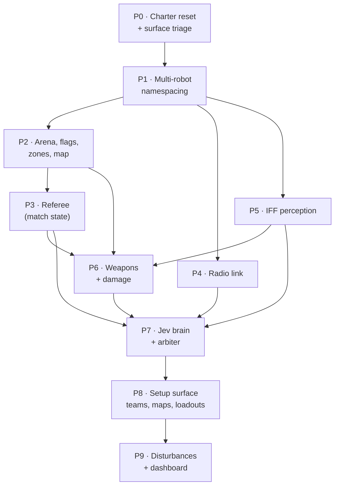

# Roadmap — Flag Ops

**Status: planning. No CTF code exists yet.** This file is the audit of the
inherited repository and the phase plan that turns it into a Capture-the-Flag
simulation. Written 2026-10-29.

Every claim below is labelled:

| Label | Meaning |
| --- | --- |
| **MEASURED** | A number produced by running something on this machine, with the method stated |
| **READ** | Read directly out of the committed source or vendor documentation |
| **UNVERIFIED** | A risk or assumption nobody has tested yet |
| **OPEN** | A decision the project owner has not made |

---

## 1. What this project now is

An operator picks a **map** and a **team preset**, is matched against a randomly
selected opponent preset, and watches two teams of simulated ground robots play
Capture the Flag: take the enemy flag, carry it to your own goal zone, shoot,
take cover, call for help, and answer a teammate's call.

Each robot runs its own autonomy stack, holds its **own** world model, decides
through a **decision model** (TypeSafe's Jev), and communicates with teammates
over a **modeled radio link**. Nothing is coordinated through shared memory and
nothing is resolved from simulator truth except by the referee.

The inherited engineering standard is unchanged and takes precedence over
gameplay: behaviour must emerge from the simulated robots, their sensors, their
actuators and their software, or it does not ship. See `ENGINEERING.md`.

### What changed from the inherited project

`flag-ops` is a copy of `breakmyrobot` (Resilient Autonomy Lab) — a
single-robot navigation lab. Three of its governing statements are now **false**
and are rewritten in P0:

- `README.md:30` — "The user is selecting one robot for an experiment, not
  commanding a fleet of robots simultaneously. Multi-robot coordination is
  outside the MVP."
- `README.md:59` — "Simultaneous fleet control or multi-robot coordination" is
  listed as explicitly out of scope.
- `ENGINEERING.md:26` — "Selecting one platform for a run is required;
  commanding multiple robots simultaneously is not."

Until those are rewritten, every future working session is in conflict with the
repository's own instructions.

---

## 2. Inherited baseline

READ, from the committed tree:

| Subsystem | State | Fate |
| --- | --- | --- |
| gz Harmonic world + `ral_roomba` / `ral_car` models + `ros_gz` bridge | working, measured | **keep** |
| Nav2 + AMCL on the roomba, against a committed map | working, measured | **keep**, trimmed and namespaced |
| ArduRover SITL + MAVROS + EKF3 on the car | working, measured | **OPEN** (§7) |
| `ral_faults` fault manager with per-platform capability refusal | working, 5 faults | **keep**, re-aimed |
| `ral_eval` bag → metrics → docs evidence harness | working | **keep**, must become multi-robot |
| `ground_truth_node`, `frames.py`, `grid.py` | working | **keep**, now also feeds the referee |
| Dashboard gateway (SSE + POST) and React console | working | **keep**, "one stack" → "one match" |
| SLAM map-building path | working, offline | **keep** — how a new arena gets an honest map |
| Single-robot acceptance scenarios | 13 committed | **mostly delete** (§6) |

### Measured facts that constrain the plan

**MEASURED 2026-10-29** — real-time factor against robot count. Method: the
committed `ral_apartment.sdf` with *N* `ral_roomba` bodies spawned at 0.8 m
spacing, each with its own 360-sample 10 Hz gpu_lidar and contact sensor,
`gz sim -s -r --headless-rendering`, **no autonomy stack running**, sampled from
`/world/ral_apartment/stats` after 35 s. Unthrottled rows set
`<real_time_factor>0</real_time_factor>`.

| Robots | Throttled RTF | Unthrottled RTF (steady state) | Simulator headroom |
| --- | --- | --- | --- |
| 1 | 0.9996 – 1.0013 | 3.55 – 9.06 | ~4× |
| 2 | 0.9962 – 1.0017 | not measured | — |
| 4 | 1.0004 – 1.0020 | 1.38 – 1.75 | **~1.5×** |

Two conclusions:

1. **Lidar is not the constraint.** Four full 360-beam lidars cost nothing
   detectable. An earlier proposal to halve them to 180 samples is **retracted**
   as unjustified.
2. **The remaining margin is CPU and it is thin.** The simulator alone leaves
   roughly 1.5× at four robots, before a single Nav2 or AMCL process starts.
   Host: i7-1255U, 12 threads, 15 GiB RAM, Intel iGPU (`docs/gate.md`).

**MEASURED** — `/imu` is published at 100 Hz, bridged, and recorded, and
**nothing subscribes to it** anywhere in `ros2_ws/src`.

**READ** — `nav2_roomba.yaml:55-60`: AMCL runs `max_particles: 2000` but
consumes only `max_beams: 60` of the 360-sample scan. The expensive sensor
serves the costmap, not localization.

**READ** — the apartment world is geometry-only; bodies are spawned at runtime
through `/world/<world>/create`, so multi-robot spawning needs no world edit.

### The decision model

**READ**, from TypeSafe and OpenRouter documentation:

| Property | Value | Consequence for this project |
| --- | --- | --- |
| Model family | System One decision model, not an LLM | It **selects**, it cannot plan. The arbiter must enumerate legal actions each tick. |
| Primitives | `Choice`, `Score`, `Noul`, `Box` (1.14, images) | `Choice` = action, `Noul` = gate, `Score` = priority |
| Output | typed answer + per-option probabilities + confidence | The probability vector is the **only** internal evidence. There are no reasoning traces. |
| Latency | 70 – 500 ms end-to-end | Fits a 1–2 Hz deliberative tier |
| State limit | > ~32,000 bytes enters long-context mode, "slower and less accurate" | The world-model snapshot has a hard byte budget |
| Context | 262,144 tokens | Not a limit we will approach |
| Cost | $0.042 / M input tokens, output free, `usage.cost` per response | Per-match cost is loggable and must be logged |
| SDKs | `typesafe-sdk` (Python ≥ 3.10), `@typesafe-ai/sdk` | **Not used.** The image has no pip (below); P7 calls the REST endpoint with stdlib `urllib.request` + `json` |
| Endpoints | `POST api.typesafe.ai/v1/systemone` (`jev-latest`), or OpenRouter `POST /api/alpha/decisions` (`typesafe/jev-1.14`) | Either; key handling decided in P0 |

**MEASURED 2026-10-29**, inside `ral:dev` via `scripts/dev.sh`:

| Question | Command | Result |
| --- | --- | --- |
| Container Python version | `python3 --version` | `Python 3.10.12` |
| TLS available | `python3 -c "import ssl; print(ssl.OPENSSL_VERSION)"` | `OpenSSL 3.0.2 15 Mar 2022` |
| pip available | `which pip pip3` | **nothing** — the image installs Python packages through apt only |
| Outbound HTTPS | `urllib.request.urlopen(Request("https://api.typesafe.ai/v1/systemone", method="OPTIONS"), timeout=10)` | `HTTPError HTTP Error 405: Method Not Allowed` |

A 405 is a reply from the endpoint, so DNS, TCP and the TLS handshake all
succeeded; outbound HTTPS from the container works. **Decision, taken in P0:**
P7 reaches the decision model with stdlib `urllib.request` and `json`. No SDK
and no `python3-pip` layer is added to the Dockerfile. No API key is used,
requested or committed anywhere in P0–P5.

---

## 3. Phase graph

**P3 is the first playable milestone** — a match that can be won with no
weapons and no AI. **P7 is the first interesting one.**

---

## 4. Phases

### P0 — Charter reset and inherited-surface triage

Rewrite the governing documents, then decide the fate of every inherited
subsystem before anything is built on top of them.

- **Requirements:** `README.md`, `ENGINEERING.md` and `CLAUDE.md` describe the
  CTF mission and put multi-robot operation *in* scope. A written keep / park /
  delete inventory covering every package. Verified: container Python version,
  `typesafe-sdk` installability, outbound HTTPS from the container, API key
  handling (never committed, never logged).
- **Constraints:** zero behaviour change. `baseline_roomba` must still produce
  metrics inside its recorded spread afterwards — it is the platform regression
  anchor for every later phase.
- **Removes:** the IMU sensor and its bridge entry (MEASURED: no consumer),
  `/joint_states` and the joint-state publisher plugin, `smoother_server`,
  `waypoint_follower` + `WaitAtWaypoint`, the `AssistedTeleop` behaviour.
- **Enables:** everything. Nothing else may start while the documents say the
  opposite of the plan.
- **Proof:** build green; `baseline_roomba` re-run and compared against
  `docs/repeatability-baseline_roomba.md`.

### P1 — Multi-robot namespacing

Four namespaced roombas, each with its own TF prefix and AMCL instance, one
shared map server, four independent goals. The largest mechanical risk in the
project and the least interesting — which is exactly why it goes first.

- **Requirements:** `namespace` added to the robot profile; per-robot bridge
  configuration generated rather than hand-written; TF frames prefixed; every
  `ral_eval` node parameterised by namespace; `run_scenario` recording a
  per-robot topic set.
- **Constraints:** the autonomy stacks must fit inside the ~1.5× simulator
  headroom MEASURED above. Levers, in order of preference: AMCL `max_particles`
  2000 → ~600 (verify `est_error_*` does not degrade), `DWBLocalPlanner` →
  `RegulatedPurePursuit` (tradeoff: DWB handles *moving* obstacles better, and
  enemy robots are moving obstacles — decide on measurement, not taste), then
  reduce team size to 1v1.
- **RTF below 1.0 is acceptable here** because every metric derives from
  `/clock` (`docs/gate.md`). **That argument expires at P7** — see the
  sim-time deadline constraint.
- **Proof:** `docs/multi-robot-gate.md` — RTF, CPU, RAM and per-robot
  `est_error_*` at N = 1, 2, 4, with the autonomy stacks running.

### P2 — Arena, flags, zones, map

A symmetric CTF world with real cover geometry, its occupancy map built through
the existing SLAM path, and flag and goal-zone definitions in the map frame.

- **Requirements:** cover that blocks both lidar returns and shot rays; two flag
  spawn poses; two goal zones; a map produced by `map_build.launch.py`, not
  drawn by hand.
- **Constraints:** **a symmetric arena is a global-localization hazard.** AMCL's
  particle filter can legitimately converge on the mirrored pose. Mitigation:
  per-robot known start poses (as today) plus deliberately asymmetric cover
  detail. This is a genuine robotics problem and belongs in the documentation,
  not designed out of existence. Arena diameter stays inside the 12 m lidar
  range.
- **Depends on:** P1 (multi-spawn). **Enables:** P3, P6.

### P3 — Referee

The match rules engine: flag possession, zone capture, score, match clock,
terminal outcome. No weapons yet.

- **Requirements:** a match state machine; flag pickup by proximity on **true**
  pose; a carrying state; capture on entering the carrier's own goal zone;
  terminal conditions; a sim-timestamped event log. Extends the existing
  `test_mission_vocabulary.py` outcome vocabulary rather than replacing it.
- **Constraints:** the referee is the **only** consumer of ground truth besides
  evaluation. Anything a robot learns from the referee — score, "flag taken" —
  must be declared as a public scoreboard broadcast, not silent omniscience.
  **OPEN:** does carrying the flag change anything physical (mass, top speed) or
  is it pure state? Either is acceptable; unstated is not.
- **Proof:** a match ending 1–0, driven by scripted Nav2 goals, with the full
  event log. Playable CTF with zero AI and zero weapons.

### P4 — Radio

A per-robot radio endpoint with a modeled link: range limit, packet loss,
latency, and jammable.

- **Requirements:** a message set (enemy sighting, help request, help
  acknowledgement, flag status, intent); delivery decided referee-side from true
  positions; message **content** drawn only from the sender's own knowledge;
  each robot merging received messages into its own world model with staleness
  tracking.
- **Constraints:** this must not degenerate into a shared blackboard. Two
  teammates must be able to hold contradictory beliefs about the same enemy.
  That is the entire point of modelling the link.
- **Enables:** the "call for help" and "act on a teammate's help call" tools
  from the product brief, which are meaningless without it. Also the first
  genuine communication fault in the project's history — `ENGINEERING.md` §5
  lists the category, and nothing has ever implemented it.

### P5 — IFF perception

A `logical_camera` per robot: field of view, range, occlusion, model identity.

- **Requirements:** a written sensor-model document stating what it does and
  does **not** model — no misclassification, no false positives, no dropouts
  unless injected. Without that statement it reads as omniscience.
- **Constraints:** **UNVERIFIED** — whether `ros_gz_bridge` in this image
  supports `LogicalCameraImage`. Fallback is a small gz-transport → ROS node.
  Check during P0.
- **Later option:** Jev's `Box` primitive on a camera frame is a real visual
  localization path, but at 70–500 ms and a per-call cost it can only ever be a
  slow confirmation channel, never a 10 Hz sensor. Not in this plan.

### P6 — Weapons and damage

Ray-based shot resolution, a reload and fire-rate state machine, 3 hit points,
elimination.

- **Requirements:** the shot ray originates at the muzzle's **true** pose and is
  aimed at the **estimated** target position, so misses are caused by estimation
  error; the hit is resolved by ray intersection against the same SDF collision
  geometry the robots drive through; damage is applied by the referee.
- **Constraints:** cover then works for free and can never disagree with the
  world — this is the whole reason to resolve shots in the simulator rather than
  in a second 2D model of the map. Fire rate and reload are counted in **sim**
  time. **UNVERIFIED:** the gz Harmonic ray-intersection service surface as
  called from a ROS node.
- **Depends on:** P3 (referee owns damage), P5 (something to aim at), P2
  (cover).

### P7 — Jev brain and arbiter

The deliberative tier. The arbiter enumerates feasible actions, Jev selects, the
arbiter validates and executes.

- **Requirements:**
  - One typed action-space enum shared by the arbiter and the Jev `Choice`
    criteria. One source of truth, or the two drift apart silently.
  - A state serialiser building a compact snapshot from **robot-local knowledge
    only**: own pose estimate, health, ammunition and reload state, teammate
    reports with age, enemy tracks with age, flag status, nearest known cover.
  - `Noul` for gates ("advancing is safe"), `Score` for target priority,
    `Choice` for the action.
  - Every call logged: state, questions, answer, the full probability vector,
    confidence, `usage.cost`, and **both** wall and sim timestamps.
  - A replay mode that re-runs a match from the decision log.
  - A deterministic fallback policy for a missed deadline or a failed call.
- **Constraints:**
  - **The state stays under 32,000 bytes.** Above that Jev degrades, by its own
    documentation.
  - **The decision deadline is pinned in sim time, not wall time.** At RTF 0.5 a
    300 ms API call costs the robot 150 ms of sim time, so the brain appears
    faster the more loaded the host is and match outcomes stop being
    reproducible. The arbiter holds the decision until a declared sim-time
    deadline regardless of when the answer arrived.
  - Jev returns no reasoning. The dashboard labels its numbers **"Jev calibrated
    probability"**, never "robot confidence" — the latter is exactly the
    fabricated-confidence failure `ENGINEERING.md` §4 names.
  - A late or unavailable brain is a first-class modeled fault, not an outage.
- **Depends on:** P3, P4, P5, P6.

### P8 — Setup surface

Map presets (team size, flag positions, goal zones), team presets (brain
question set, thresholds, tool preferences), random opponent selection.

- **Requirements:** a preset schema that **cannot express an unsupported
  combination** — the same refuse-rather-than-guess rule the fault manager
  already enforces per platform.
- **Constraints:** the profile system is per-**platform**. CTF needs
  per-**instance** identity — team, callsign, role, loadout. That is a new
  concept, not an extension of `robots/<robot>.yaml`.

### P9 — Disturbances and dashboard

Re-aim `ral_faults` at the match — jamming, sensor blinding, mobility damage,
weapon jam, brain outage — and give the console a match view, per-robot panels,
a decision log and an event timeline.

- **Constraints:** every fault still names its injection point, affected
  consumer, expected observable consequence, removal path and limitations, per
  `ENGINEERING.md` §5. `kidnap` keeps its mechanism but leaves the match fault
  menu: nobody picks up a robot mid-firefight.

---

## 5. Audit — missing

No equivalent exists anywhere in the inherited repository:

| Gap | First needed |
| --- | --- |
| Per-robot instance identity (team, callsign, role, loadout) | P1 |
| A typed action space shared by arbiter and decision model | P7 |
| A sim-time-pinned decision deadline | P7 |
| Replay and determinism for hosted model calls | P7 |
| A modeled radio link of any kind | P4 |
| Any means of detecting another agent | P5 |
| A referee / match state machine | P3 |
| Match-outcome vocabulary (win, loss, draw, timeout, team eliminated) | P3 |

## 6. Audit — redundant

| Item | Evidence | Action |
| --- | --- | --- |
| IMU sensor, 100 Hz, bridged and recorded | MEASURED: no subscriber in `ros2_ws/src` | delete, P0 |
| `/joint_states` + joint-state publisher plugin | feeds wheel TF only; nothing in CTF reads it | delete, P0 |
| `smoother_server` (`SimpleSmoother`) | cosmetic path smoothing, one lifecycle node per robot | delete, P0 |
| `waypoint_follower` + `WaitAtWaypoint` | no consumer; the brain issues one goal at a time | delete, P0 |
| `AssistedTeleop` behaviour | no teleop operator exists in CTF | delete, P0 |
| `blocked_goal_roomba`, `obstacle_cleared_roomba`, `control_occupied_goal`, `kidnap_*` scenarios | encode a single-robot point-to-point mission that no longer exists | delete, P0 |
| `narrow_doorway_roomba`, `narrow_doorway_car` | **AMENDED in P0, reversing the earlier "delete" verdict.** With the car parked rather than deleted (§7.1), this pair is the only committed evidence that an Ackermann vehicle with a 0.611 m minimum turning radius behaves differently from a differential-drive robot. `ENGINEERING.md` §2 and MVP acceptance scenario 4 rest on it | **keep** |
| `baseline_roomba`, `baseline_car` | the regression anchors every later phase is compared against | **keep** |
| `obstacle_roomba`, `scan_degraded_roomba`, `mobility_fault_roomba`, `mobility_fault_car` | the only committed evidence that `ral_faults` changes the world | **keep**, re-aimed in P9 |
| Car / ArduRover / MAVROS stack | ~⅓ of the autonomy code, the only MAVLink in the project, and no SITL process runs in a 2v2 diff-drive match | **parked**, §7 |

## 7. Open decisions

1. **Car stack: park or delete. DECIDED 2026-10-29 by the project owner: park.**
   `car_nav.launch.py`, `mavros_car.yaml`, `rover_ackermann.parm`,
   `mavros_driver.py`, `ekf_local_tf.py`, `bridge_car_*`, `models/ral_car/`,
   `config/robots/car.yaml`, the car scenarios, `docs/car-closed-loop.md` and
   `docs/repeatability-baseline_car.md` stay buildable, tested and evidenced,
   and out of the match path. Platform asymmetry (a vehicle that cannot rotate
   to aim, 0.611 m minimum turning radius) is this project's strongest
   differentiator once the match loop works, and deleting it would cost a full
   SITL reintegration later. `scripts/checks/car_nav_check.sh` returning 13/13
   is the measurement that proves the park is intact, and every phase re-runs
   it.
2. **Does carrying the flag change anything physical? DECIDED 2026-10-29 by the
   project owner: no — it is referee-held state with a consistent world model.**
   On pickup the referee removes the flag entity through the already-bridged
   `/world/<w>/remove`; on drop or return it re-creates it through
   `/world/<w>/create` at the drop pose. Carrying changes no mass, no top speed
   and no sensor signature. That sentence must appear wherever the flag is
   described. (P3)
3. **Jev access path: DECIDED in P0 — stdlib `urllib.request` against
   `POST api.typesafe.ai/v1/systemone`.** See the MEASURED table in §2: the
   image has no pip, so no SDK is installable, and outbound HTTPS works. Which
   key and how it is supplied is a P7 decision; no key is used, requested or
   committed in P0–P5.

## 8. Risk register — unverified

| Risk | Phase | Fallback |
| --- | --- | --- |
| Four Nav2 + AMCL stacks do not fit the ~1.5× simulator headroom | P1 | particle reduction → controller swap → 1v1 |
| `ros_gz_bridge` has no `LogicalCameraImage` support in this image | P5 | custom gz-transport → ROS bridge node |
| gz Harmonic ray-intersection service not callable from a ROS node | P6 | sensor-based alternative, or a declared limitation |
| Symmetric arena breaks AMCL global localization | P2 | known start poses + asymmetric cover detail |
| Host RAM (15 GiB, ~2 GiB free during measurement) under 4 stacks | P1 | 1v1 |

## 9. Retracted

**"Halve the lidar to 180 samples."** Proposed before measurement, retracted
after: four full 360-beam lidars at 10 Hz cost nothing detectable in RTF. The
constraint is CPU in the autonomy stacks, not GPU in the sensors.
